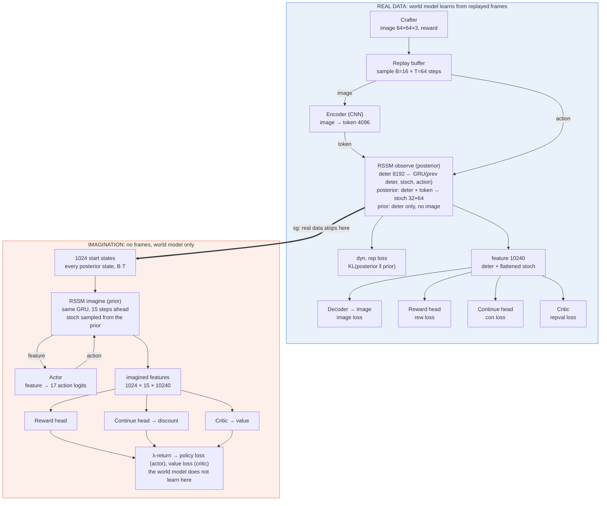

# Architecture and data flow (Task 2, milestone M2)

Shapes below are measured, not guessed: `analysis/trace_batch.py` rebuilds
the network from the config of our baseline run
(`runs/20261123-baseline-s0/config.yaml`, official `crafter` config, not
`debug`) and follows one batch through the same calls as `Agent.loss`.
It uses `jax.eval_shape`, so it runs on a laptop CPU in seconds and needs
no checkpoint:

```sh
docker compose --profile cpu run --rm train-cpu python analysis/trace_batch.py
```

## Code map

| Component | File / function | Notes |
|---|---|---|
| Encoder | `upstream/dreamerv3/rssm.py:179` `Encoder` (call: `:210`) | 4 conv layers (depth 64×(2,3,4,4), kernel 5), each followed by a 2×2 max-pool: 64×64 image → 4×4×256 → flat token of 4096 |
| RSSM: observe (posterior, real data) | `upstream/dreamerv3/rssm.py:61` `observe`, step `:75` `_observe` | Per time step: `_core` updates `deter` from previous `deter`, `stoch`, action; then `deter` + image token → posterior logits → sample `stoch` |
| RSSM: core (sequence model) | `upstream/dreamerv3/rssm.py:135` `_core` | Block GRU, 8 blocks, `deter` 8192 |
| RSSM: prior | `upstream/dreamerv3/rssm.py:161` `_prior` | 2 MLP layers on `deter` only → prior logits (no image) |
| RSSM: imagine (prior, imagination) | `upstream/dreamerv3/rssm.py:94` `imagine` | Same `_core`, but `stoch` sampled from the prior; the action comes from the actor |
| Decoder | `upstream/dreamerv3/rssm.py:253` `Decoder` (call: `:288`) | Feature → reconstructed image; used only for the `image` loss |
| Reward head | `upstream/dreamerv3/agent.py:57` `self.rew` (MLPHead) | Feature → reward, 255-bin `symexp_twohot` output, used at `:173` (real) and `:205` (imagined) |
| Continuation head | `upstream/dreamerv3/agent.py:58` `self.con` (MLPHead) | Feature → probability the episode continues, used at `:177` and `:206` |
| Actor (policy) | `upstream/dreamerv3/agent.py:62` `self.pol` (MLPHead) | Feature → logits over 17 actions. Acting: `policy` `:115`; training: imagined features `:192`, `:207` |
| Critic (value) | `upstream/dreamerv3/agent.py:65` `self.val`, slow copy `:66` | Feature → expected λ-return, 255-bin output, used at `:208` (imagined) and `:228` (replay) |
| Losses | `upstream/dreamerv3/agent.py:156` `loss`, called by `train` `:137` | See "Losses" below |
| Report / open-loop video | `upstream/dreamerv3/agent.py:247` `report` | Observes the first half of a window, imagines the second half from the real actions, decodes both. `scripts/openloop.py` calls it on a trained checkpoint (Task 4) |

"Feature" = `feat2tensor` (`agent.py:51`): `deter` and the flattened
`stoch` side by side, 8192 + 32×64 = 10240 numbers per time step. Every
head (reward, continuation, actor, critic, decoder) reads it.

## Tensors for one batch

From `analysis/trace_batch.py` with the baseline config. `B = 16`
sequences of `T = 64` steps are sampled from the replay buffer
(`batch_size`, `batch_length`). Imagination starts from **every** real
step, so `B·T = 1024` start states, each rolled out `H = 15` steps
(`imag_length`). `bfloat16` is a 16-bit float used for speed; the heads
output `float32`.

Real data (world-model training, `agent.py:164-177`):

| Name | Shape | dtype | Meaning |
|---|---|---|---|
| observation `image` | `(B, T, 64, 64, 3)` | uint8 | RGB frame, values 0–255 |
| `reward`, `is_first`, `is_last`, `is_terminal` | `(B, T)` | float32 / bool | Reward of the step; episode start; episode end; end by death (not time limit) |
| action (`prevact`) | `(B, T)` | int32 | Index of the action taken *before* each frame (17 Crafter actions) |
| encoder tokens | `(B, T, 4096)` | bfloat16 | Image compressed by the CNN encoder |
| deterministic state `deter` | `(B, T, 8192)` | bfloat16 | Recurrent memory of the RSSM (block GRU output) |
| posterior logits | `(B, T, 32, 64)` | bfloat16 | 32 categorical variables × 64 classes, computed *with* the image |
| prior logits | `(B, T, 32, 64)` | bfloat16 | Same, predicted from `deter` *without* the image; `dyn`/`rep` compare the two |
| stochastic state `stoch` | `(B, T, 32, 64)` | bfloat16 | One-hot sample of the posterior: 32 choices out of 64 |
| feature | `(B, T, 10240)` | bfloat16 | `deter` + flattened `stoch`, input of every head |
| reconstructed image | `(B, T, 64, 64, 3)` | float32 | Decoder output (mean), compared with `image / 255` |
| predicted reward | `(B, T)` | float32 | Reward head |
| continuation | `(B, T)` | float32 | Probability the episode goes on |
| critic value | `(B, T)` | float32 | Used by the `repval` loss on real data |

Imagination (actor and critic training, `agent.py:189-214`). No image,
no encoder, no decoder from here on: this is where real data stops.

| Name | Shape | dtype | Meaning |
|---|---|---|---|
| start `deter` | `(B·T, 8192)` = `(1024, 8192)` | bfloat16 | Every posterior state of the batch becomes a start point |
| imagined `deter` | `(1024, 15, 8192)` | bfloat16 | `_core` rolled forward 15 steps |
| imagined `stoch` | `(1024, 15, 32, 64)` | bfloat16 | Sampled from the **prior** (no image) |
| imagined feature | `(1024, 15, 10240)` | bfloat16 | Input of the heads |
| actor output (logits) | `(1024, 15, 17)` | float32 | Scores for the 17 actions; the action is sampled from them |
| imagined action | `(1024, 15)` | int32 | Sampled action per imagined step |
| predicted reward | `(1024, 15)` | float32 | Reward head on imagined features |
| continuation | `(1024, 15)` | float32 | Continuation head on imagined features |
| critic value | `(1024, 15)` | float32 | Critic on imagined features |

`Agent.loss` then puts the real start state in front of the 15 imagined
steps (`agent.py:196`), so the imagination losses see `H + 1 = 16` steps
per start (`assert` at `:200`).

## Losses

All losses are computed in `Agent.loss` (`upstream/dreamerv3/agent.py:156`).
They are multiplied by `loss_scales`, summed into **one** number
(`agent.py:240`) and minimised by **one** optimizer over all modules
(`agent.py:76`). What decides which network a loss trains is where the code
stops the gradient: `sg(x)` (`agent.py:17`, `jax.lax.stop_gradient`) makes
`x` a constant, so nothing before `x` learns from that loss.
`sg(x, skip=True)` does nothing.

| Loss key in `metrics.jsonl` | What it measures | Trains | Scale | Code |
|---|---|---|---|---|
| `train/loss/image` | how badly the decoder rebuilds the real image from the posterior latent state (pixel error) | decoder, RSSM, encoder | 1.0 (`rec`) | `agent.py:178-182` |
| `train/loss/rew` | how badly the reward head predicts the real reward | reward head, RSSM, encoder (`reward_grad: true`) | 1.0 | `agent.py:172-173` |
| `train/loss/con` | how badly the continuation head predicts "episode goes on" | continuation head, RSSM, encoder | 1.0 | `agent.py:174-177` |
| `train/loss/dyn` | KL from posterior (with image) to prior (without image); posterior frozen | **prior** (dynamics: predict the next state) | 1.0 | `rssm.py:125` |
| `train/loss/rep` | same KL; prior frozen | **posterior** and encoder (representation: stay predictable) | 0.1 | `rssm.py:126` |
| `train/loss/policy` | actor loss on imagined trajectories: raise the probability of actions with a high advantage, plus an entropy bonus | actor only | 1.0 | `agent.py:411-415` |
| `train/loss/value` | critic error on imagined trajectories vs the λ-return (and vs the slow critic) | critic only | 1.0 | `agent.py:417-422` |
| `train/loss/repval` | the same critic error, but on **real** replayed states | critic, and RSSM + encoder (`repval_grad: true`) | 0.3 | `agent.py:219-234`, `471` |

Notes:

- **World-model losses:** `image`, `rew`, `con`, `dyn`, `rep`. They
  use real data from the replay buffer only.
- **Imagination losses:** `policy`, `value`. Imagined states are wrapped
  in `sg` (`agent.py:196`, `ac_grads: false`), so these losses never
  change the world model. The actor learns with REINFORCE-style
  gradients (`logpi * advantage`), not by backpropagating through the
  model.
- **`dyn` and `rep` have the same value** in every log line: both are
  the KL between posterior and prior. They differ only in which side is
  frozen by `sg`, so `dyn` moves the prior towards the posterior and
  `rep` (10× weaker) moves the posterior towards the prior.
- **Free nats** (`free_nats: 1.0`, `rssm.py:127-129`): a KL below 1 nat
  is clipped to 1 and gives no gradient. A `dyn`/`rep` curve flat at 1.0
  means "prior and posterior agree well enough", not "nothing is
  learned". In the baseline the KL is still ~2 at 45k steps; in the
  debug smoke test it sat at the 1.0 floor.
- `image` is the largest number because it is a sum over 64×64×3 pixels.
  Compare its trend, not its size, with the other losses.

## Diagram

Data flow of one training step. Mermaid: GitHub draws it from the text
below, so edit the text to change the diagram. Top (blue): the world
model learns from real replayed frames. Bottom (orange): imagination,
where the actor and critic learn. The edge marked **sg** is where real
data stops: the posterior states are copied with a stop-gradient
(`agent.py:196`), and after it no image, encoder or decoder is used.
Shapes are the ones in the tables above. Not drawn, to keep the layout
readable: the same actor also plays the real game (`policy`,
`agent.py:115`), from the posterior state of the live frame.



## Imagination: how the actor and critic learn (Task 5)

The actor and critic never train on real frames. They train on
**imagined rollouts**: sequences that the world model predicts from its
latent state, without the environment and without images. Code:
`Agent.loss` (`upstream/dreamerv3/agent.py:188-214`) and `imag_loss`
(`agent.py:382`). Settings from our run's `config.yaml`.

### Steps, for one training batch

1. **Start states.** Every posterior state of the replayed batch is a
   start: `B·T = 16·64 = 1024` starts (`imag_last: 0` means "all T
   steps"). `dyn.starts`, `agent.py:191`.
2. **Rollout.** 15 times (`imag_length`): the actor picks an action from
   the feature; the RSSM core updates `deter`; `stoch` is sampled from
   the **prior** (no image). `rssm.py:94` `imagine`. The real start state
   is put in front, so each rollout has 16 states (`agent.py:196`).
3. **Heads on every imagined state** (`agent.py:202-209`): reward head
   → reward `r`; continuation head → `c`, probability the episode goes
   on; critic → value `v`; slow critic → `v_slow`.
4. **λ-return** (`lambda_return`, `agent.py:482`), computed backwards
   from the last state:

   ```
   R_15 = v_15
   R_t  = r_t+1 + c_t+1 · ((1 − λ) · v_t+1 + λ · R_t+1)
   ```

   With λ = 0.95 the target trusts the imagined rewards most and the
   critic a little. The discount is inside `c`: with `contdisc: true` the
   continuation head is trained on `(1 − 1/horizon) · not terminal`
   (`agent.py:174-176`), so `c ≈ 0.997` on safe steps.
5. **Weight.** `weight = cumprod(c)` (`agent.py:402`): a step counts less
   when the model thinks the episode may already have ended.
6. **Critic loss `value`** (`agent.py:418-422`): the critic's 255-bin
   output is pulled toward `R_t` (cross-entropy), plus a second term
   that pulls it toward the slow critic (`slowreg: 1.0`). The slow critic
   follows the critic slowly (`slowvalue.rate: 0.02` per update). A second
   critic loss, `repval` (scale 0.3), trains the same critic on real
   replayed sequences.
7. **Actor loss `policy`** (`agent.py:407-415`): REINFORCE:
   `−log π(a_t) · advantage − 0.0003 · entropy`, with
   `advantage = (R_t − v_t) / S`. `S` is the spread of the returns, the
   95th minus 5th percentile and at least 1 (`retnorm: perc, limit 1`),
   so the same settings work for small and large rewards. The gradient
   only flows through `log π`, not through the world model.

**Nothing in steps 2–7 trains the world model**: the start states and
imagined features pass through a stop-gradient (`agent.py:196`,
`ac_grads: false`). The world model learns only from real data (losses
`image`, `rew`, `con`, `dyn`, `rep`).

### Settings

| Setting | Value | Meaning |
|---|---|---|
| `imag_length` | 15 | Imagined steps per rollout. Longer: the actor sees further ahead, but model errors pile up. Our sensitivity run uses 5 (`20261124-imag5-s0`) |
| `horizon` | 333 | Discount γ = 1 − 1/333 ≈ 0.997. A reward 333 steps ahead counts ≈ 0.997³³³ ≈ 0.37 of an immediate one. Rewards beyond 15 imagined steps enter only through the critic `v_15` |
| `imag_loss.lam` | 0.95 | λ of the λ-return: 1 = sum of imagined rewards + critic only at the end; 0 = one reward + critic at the next step |
| `imag_loss.actent` | 0.0003 | Entropy bonus: keeps the actor from becoming deterministic too early |
| `retnorm` | 5th–95th percentile, limit 1 | Scale of the advantage (step 7) |
| `slowvalue.rate` | 0.02 | How fast the slow critic follows the critic |

### Evidence from the baseline

Figure: `docs/figures/20261123-baseline-s0-imagination.svg`
(`analysis/plot_curves.py`). Top row: real side (episode return, three
world-model losses). Bottom row: imagination side. Values from
`runs/20261123-baseline-s0/metrics.jsonl`, mean of the first 3 vs the
last 10 log lines:

| Metric (`train/...`) | Start (~3k steps) | ~213k | ~495k | End (~960k) | Reading |
|---|---|---|---|---|---|
| `ent/action` actor entropy | 1.18 | 0.19 | 0.28 | 0.30 | Uniform over 17 actions would be ln 17 = 2.83 nats. The actor is almost deterministic in imagination |
| `val` critic value | 1.33 | 1.65 | 2.43 | 3.19 | Expected return rises, like the real return (2.0 → 4.5 → 9.3 → 11.3 per episode) |
| `adv_mag` \|advantage\| | 0.081 | 0.034 | 0.029 | 0.024 | Imagined actions are rarely much better than the critic expects: the actor has settled |
| `weight` | 0.93 | 0.95 | 0.95 | 0.95 | Over 16 imagined steps the model rarely predicts the end of the episode |
| `rew` imagined reward per step | 0.036 | 0.035 | 0.047 | 0.059 | Real: 0.022 per step at 213k (4.45 / 199), 0.045 at 495k (9.26 / 208), 0.048 at 960k (11.30 / 236), last 100 training episodes |

At ~213k the imagined reward per step is about 1.6 times the real one.
This suggests the world model is **optimistic** about reward, or the actor
finds rewards in imagination that it does not reach in the real game.
Task 4 (open-loop prediction) and Task 8 (reward-model errors) check this
on real trajectories. At ~495k imagined and real reward per step agree
(0.047 vs 0.045): the optimism is gone. At ~960k it is back, smaller:
imagined 0.059 vs real 0.048, about 1.2 times. The figure spans the
full run to ~960k; its short spikes at ~213k and ~495k are restarts
from a checkpoint.
