# Failure cases (Task 8)

Where the world model and our runs fail, with the numbers that show it.
Draft for the error-analysis section of the report (deliverable 9).

Data: open-loop run `20261124-openloop-s0` (`scripts/openloop.py`,
baseline checkpoint ~213k env steps, 30 windows of 64 steps). In each
window the model sees 32 real frames (context), then predicts the next 32
from the actions alone (open loop). Numbers and figure:

```sh
python analysis/failures.py 20261124-openloop-s0
```



## 1. Image error grows with the horizon

| Steps ahead | 1 | 2 | 4 | 8 | 16 | 32 |
|---|---|---|---|---|---|---|
| World model MSE | 0.011 | 0.012 | 0.018 | 0.023 | 0.027 | 0.032 |
| Copy last real frame | 0.006 | 0.009 | 0.015 | 0.030 | 0.037 | 0.034 |

- The error triples in 32 steps (0.011 to 0.032). Each imagined step
  starts from the previous imagined state, so mistakes add up. The model
  never sees a real frame again to correct itself.
- For the first 6 steps the model is **worse** than simply repeating the
  last real frame. The scene barely changes in a few steps, so copying is
  hard to beat. The decoder also blurs details even in context
  (MSE 0.008 at the last context frame, where copying scores 0).
- From step 7 on the model is better (26 of 32 steps). It knows how the
  view moves when the player walks; the copy does not.
- At step 32 both are close again (0.032 vs 0.034): the prediction has
  lost most of what is specific to this window.

What fails visually (`runs/20261124-openloop-s0/media/openloop.png`): the
player and the large terrain (grass, water) stay. Small and rare things
fade: trees, sand edges, cows. The model keeps the
average look of the world and drops the details that matter for
achievements (a cow to eat, a tree to collect wood).

## 2. Reward model: false alarms and missed sparse rewards

Crafter gives +1 the first time an achievement is unlocked and ±0.1 when
health changes. We sum the reward over the 32 open-loop steps of each
window and call a sum of at least 0.5 "an achievement happened".

| | Real: achievement | Real: none |
|---|---|---|
| **Predicted: achievement** | 6 (hit) | 9 (false alarm) |
| **Predicted: none** | 4 (missed) | 11 |

- **Over-estimation.** Mean predicted reward per window is 0.53, real
  0.26: twice too high. Most of the gap comes from the 9 false alarms,
  where the model predicts a full +1 (dots at x ≈ 1, y = 0 in the
  figure). Possible causes (not tested): the imagined world drifted
  from the real one, or the model does not know which achievements
  are already unlocked (+1 is paid only the first time).
- **Missed sparse rewards.** In 4 of the 10 windows with a real
  achievement, the model predicted none (dots at x ≈ 0, y ≥ 0.7), one window with +2. Achievements
  are rare in replay, so the reward head sees few examples of them.
- **Health penalties are missed.** 8 windows lose health (real sum
  −0.34 on average); the model predicts +0.24 there. It does not see the
  damage coming (hunger, thirst, zombies) without real frames.

Why it matters: the actor learns only from imagined rewards
(`docs/architecture.md`, Imagination). False alarms push it toward
actions that pay nothing in the real game. Missed rewards and missed
damage hide what it should learn or avoid.

## 3. Continuation: no deaths to test

The continue head predicts ≥ 0.997 at every step, and no window contains
an episode end. Episodes last 158–430 steps, so a 64-step window rarely
reaches a death. This is a gap in the test, not evidence that the head
predicts deaths well. To test it: cut windows that end at the last step
of an episode.

## 4. Same test at ~495k steps

Run `20261125-openloop500k-s0`: same script, same 10 worlds (seed 100),
checkpoint of `20261123-baseline-s0` at ~495k env steps. 27 windows
(two episodes were shorter than 64 steps).

```sh
python analysis/failures.py 20261125-openloop500k-s0
```



| Steps ahead | 1 | 2 | 4 | 8 | 16 | 32 |
|---|---|---|---|---|---|---|
| World model MSE, ~213k | 0.011 | 0.012 | 0.018 | 0.023 | 0.027 | 0.032 |
| World model MSE, ~495k | 0.020 | 0.021 | 0.023 | 0.029 | 0.040 | 0.048 |
| Copy last real frame, ~495k | 0.007 | 0.010 | 0.016 | 0.029 | 0.033 | 0.038 |

| Reward windows | Hit | False alarm | Missed | Neither | Mean predicted / real |
|---|---|---|---|---|---|
| ~213k | 6 | 9 | 4 | 11 | 0.53 / 0.26 |
| ~495k | 6 | 6 | 7 | 8 | 0.50 / 0.70 |

- **Image error is higher, and the model beats the copy at only one
  step.** This does not show that the model got worse. The two tests see
  different frames: the 495k agent survives longer (episodes of 56–428
  steps, mean 258, against 202 at 213k), so its windows reach **night**
  and caves. Crafter draws night frames darker and adds random noise to
  them (`runs/20261125-openloop500k-s0/media/openloop.png`, dark rows).
  No model can predict that noise pixel by pixel, and the decoder
  already errs in context (MSE 0.021 against 0.009 at 213k).
- **Reward flips from too high to too low.** Fewer false alarms (6 vs 9),
  more missed rewards (7 vs 4). The agent now unlocks more achievements
  per window (real mean 0.70 vs 0.26) and the model misses many of them.
- **Health losses still not foreseen.** 4 windows lose health (real
  mean −0.23); the model predicts +0.93 there.
- **Continuation**: minimum 0.960, still no episode end in a window.

A fair comparison would feed the *same* recorded frames and actions to
both checkpoints. Our script records new episodes with each checkpoint's
own policy, so it cannot do that (not done, see Limits).

## 4b. Same test at ~960k steps

Run `20261126-openloop1m-s0`: same script and worlds, checkpoint of
`20261123-baseline-s0` at ~960k env steps (its last complete save). 30
windows; episodes of 174–427 steps, mean 227.

```sh
python analysis/failures.py 20261126-openloop1m-s0
```



| Steps ahead | 1 | 2 | 4 | 8 | 16 | 32 |
|---|---|---|---|---|---|---|
| World model MSE, ~960k | 0.018 | 0.019 | 0.021 | 0.027 | 0.034 | 0.042 |
| Copy last real frame, ~960k | 0.007 | 0.011 | 0.016 | 0.028 | 0.032 | 0.038 |

| Reward windows | Hit | False alarm | Missed | Neither | Mean predicted / real |
|---|---|---|---|---|---|
| ~960k | 17 | 3 | 7 | 3 | 1.08 / 1.35 |

- **Image error is lower than at ~495k at every step**, but still above
  213k. The model beats the copy only at steps 7 to 12 (6 of 32 steps);
  from step 13 on copying the last frame is better. The windows again
  include night frames, so the caveat of section 4 holds.
- **Rewards: many more hits** (17 vs 6), few false alarms (3), but 7 of
  24 achievement windows are still missed and the mean stays too low
  (1.08 vs 1.35). The agent unlocks about twice as much per window as
  at 495k.
- **Health losses still not foreseen.** 2 windows lose health (real
  mean −0.40); the model predicts +0.20 there.
- **Continuation**: minimum 0.997, no episode end in a window.

## 5. Crashed and failed runs

From `EXPERIMENTS.md` (rows are never deleted):

| Run / job | What failed | Cause | Fix |
|---|---|---|---|
| `20261109-smoke-j148884` | killed by the 30 min time limit | `--run.duration` is not read by upstream `e3f0224`; the run never stopped | smoke uses `--run.steps 100000` |
| `20261124-openloop-s0`, job 172547 | crashed after recording the episodes | upstream's JAX transfer guard refuses an implicit GPU-to-host copy; CPU tests did not show it | explicit `jax.device_get` (commit `7bf2bb4`), job 172548 |
| `20261123-baseline-s0` | stopped by hand at 213,620 of 1.1M steps | time budget of the project, not a crash | resumed with the same run ID to 500k (job in `EXPERIMENTS.md`) |
| all nine 1M runs (jobs 175280–175283, 175290–175297) | killed by SLURM at 956k–979k env steps, each while saving a checkpoint (`oom_kill`) | host memory above the job's `--mem=64G`; memory use grows during training (cause not measured) | kept as final runs; evals use each run's last complete save, ~960k. A rerun would need more `--mem` |
| `20261126-eval500k-imag30-s{0,1,2}` | not run | the `early-ckpt` copy at ~500k was never made, so no checkpoint exists | none; horizon 30 is compared at ~960k only |
| 500k evals, first submit | `git switch` refused on the cluster clone | the resumed runs rewrote their committed `env.txt` | `scripts/perun.sh` restores such a file when it matches the committed copy (PR #60) |
| every PERUN job up to 175209 | `env.txt` shows the host's Python 3.9 without JAX and an empty Git section | `slurm/common.sh` set `SIF` without `export`, so `scripts/env_snapshot.sh` (a child process) never used the image | `export SIF`; the real versions of those runs are the image's (`Dockerfile`: Python 3.11, `jax[cuda]` 0.5.0) and the commit is in `EXPERIMENTS.md` |

Lesson for both crashes: a flag or code path that works on the laptop
CPU can fail on the cluster GPU. The staged workflow (`docs/hpc.md`:
local, interactive, smoke, production) caught both before a long run
was lost.

## Limits of this analysis

- One seed, 27–30 windows per checkpoint: the counts in sections 2
  and 4 are small. Treat them as examples, not rates.
- The 213k and 495k tests record different episodes (each with its own
  policy), so their image errors are not directly comparable.
- MSE is a pixel measure. It rewards blur and ignores whether a small,
  important object (a cow) is right.
- The windows follow the trained policy, so they cover the states that
  policy visits, not all of Crafter.
