# GPU execution evidence (deliverable 8)

What ran on the PERUN cluster, how long it took, and how busy the GPU was.
Scripts: `slurm/` (how to use them: [`hpc.md`](hpc.md)). Every job below
has a row in [`EXPERIMENTS.md`](../EXPERIMENTS.md) with its commit and
flags.

All jobs: one NVIDIA H200, Apptainer image `dreamerv3.sif` built from our
`Dockerfile` (Python 3.11, `jax[cuda]` 0.5.0), code of the listed commit
bind-mounted over `/app` (`slurm/common.sh`).

## 1. Staged workflow, with job IDs

| Stage | Script | Job(s) | Result |
|---|---|---|---|
| 1. Local test | `scripts/check_local.py` (Docker, laptop CPU) | – | passes; also the local CPU debug run `20261001-debug-cpu` |
| 2. Interactive `srun` test | `slurm/00_interactive.sh` | not recorded | see "Gaps" below |
| 3. Smoke test | `slurm/01_smoke.sbatch` (debug config) | 148884, 172451 | 148884 hit the 30 min limit (step-limit flag not read); fixed, 172451 stopped by itself at 100k steps in ~11 min |
| 4. Production | `slurm/02_train.sbatch` (official `crafter` config) | 172453, 173386, 172542, 173387, 173430–173433; then 175290–175292, 175295–175297 (resume) and 175280, 175282, 175283 (horizon 30) | six runs to ~495k env steps, then all nine to ~960k (killed for memory, section 3) |
| Evaluation | `slurm/03_eval.sbatch` | 172543–172545, 173381, 175203–175208, 176615–176622, 176678; gameplay videos 176680 | 50 episodes each, < 7 min |
| Open loop | `slurm/04_openloop.sbatch` | 172547 (crash), 172548, 175209, 176679 | < 15 min |

The smoke test found the step-limit bug, and the first open-loop job
found a GPU-only crash. Both were fixed before any long run was lost
([`failures.md`](failures.md), section 5).

## 2. Wall-clock time

From the `EXPERIMENTS.md` rows (start and end times in the job logs).

| Run | Jobs | Wall-clock |
|---|---|---|
| `20261123-baseline-s0` | 172453 (to 213k) + 173386 (resume to 500k) | 3 h 46 min + ~5 h |
| `20261124-imag5-s0` | 172542 (to 213k) + 173387 (resume to 500k) | ~2 h 20 min + ~4.5 h |
| `20261124-baseline-s1`, `-s2` | 173430, 173431 | ~9 h each |
| `20261124-imag5-s1`, `-s2` | 173432, 173433 | ~8 h each |
| horizon 15, three seeds, ~495k to ~960k | 175290–175292 | ~8 h each |
| horizon 5, three seeds, ~495k to ~960k | 175295–175297 | ~7 h each |
| `20261125-imag30-s0`, `-s1`, `-s2`, 0 to ~960k | 175280, 175282, 175283 | ~19 h each |

The rows for the 1M jobs have no recorded wall-clock (the jobs were
killed); their times are env steps divided by the measured speed in
section 3. About 150 GPU-hours of training in total, plus about 3
GPU-hours of evaluation, open-loop and video jobs.

## 3. GPU utilisation and speed

Upstream DreamerV3 logs hardware use into `metrics.jsonl` every few
minutes (about 230–260 samples per run). To recompute the table and the
figure:

```sh
python analysis/gpu_usage.py 20261123-baseline-s0 20261124-imag5-s0 \
    20261124-baseline-s1 20261124-baseline-s2 20261124-imag5-s1 \
    20261124-imag5-s2 20261125-imag30-s0 20261125-imag30-s1 \
    20261125-imag30-s2 20261123-smoke-j172451
```

| Run | GPU busy | GPU memory bandwidth | Env steps/s | Trained steps/s | RAM (GB) | Hours for 500k at this speed |
|---|---|---|---|---|---|---|
| `20261123-baseline-s0` | 85% | 27% | 15.9 | 8144 | 33.3 | 8.7 |
| `20261124-imag5-s0` | 84% | 27% | 17.8 | 9096 | 33.5 | 7.8 |
| `20261124-baseline-s1` | 88% | 28% | 16.0 | 8197 | 32.7 | 8.7 |
| `20261124-baseline-s2` | 88% | 28% | 16.0 | 8215 | 33.2 | 8.7 |
| `20261124-imag5-s1` | 85% | 27% | 17.8 | 9112 | 33.6 | 7.8 |
| `20261124-imag5-s2` | 87% | 28% | 17.7 | 9072 | 32.9 | 7.8 |
| `20261125-imag30-s0` | 89% | 28% | 13.9 | 7113 | 32.2 | 10.0 |
| `20261125-imag30-s1` | 89% | 28% | 13.9 | 7113 | 32.3 | 10.0 |
| `20261125-imag30-s2` | 88% | 27% | 13.9 | 7112 | 31.9 | 10.0 |
| `20261123-smoke-j172451` | 15% | 0% | 180.6 | 1448 | 2.4 | 0.8 |

All values cover the whole run, up to ~960k steps.

Columns:

- **GPU busy**: mean of `usage/nvsmi/compute_avg/gpu0`, the share of
  time at least one GPU kernel was running (nvidia-smi "GPU Utilization").
- **GPU memory bandwidth**: mean of `usage/nvsmi/memory_avg/gpu0`, the
  share of time GPU memory was being read or written. It is not how
  full the memory is.
- **Env steps/s**: median of `fps/policy`, real Crafter steps per second.
  **Trained steps/s**: median of `fps/train`, replayed steps the model
  trains on per second. Their ratio is about 512, the `train_ratio`.
- **RAM**: mean memory of the training process on the host over the
  run, mostly the replay buffer.



What the numbers show:

- **The GPU is the bottleneck.** It is busy 84–89 % of the time in every
  production run, from the first log row to the last. With
  `train_ratio 512`, each real step is followed by 512 replayed steps of
  training, so the game itself costs almost nothing. A faster CPU or
  more parallel game copies would not make the run faster.
- **Horizon 5 is about 12 % faster** (17.8 vs 15.9 env steps/s), and
  **horizon 30 about 13 % slower** (13.9). The actor-critic update
  imagines 5, 15 or 30 steps. The world-model update, which is the same
  in all three, is most of the work.
- **RAM grows with the run, and that killed the 1M jobs.** The replay
  buffer keeps every real step (`replay.size` is 5e6, more than the
  1M steps of a run), so memory rises by about 6 GB per 100k steps:

  | Env steps | ~3k | ~250k | ~500k | ~750k | ~960k |
  |---|---|---|---|---|---|
  | Process RAM, `20261123-baseline-s0` (GB) | 6.2 | 20.6 | 32.6 | 47.5 | 58.6 |
  | of which replay buffer (GB) | 0.2 | | 24.9 | | 48.8 |

  All nine runs reached 58–59 GB near 960k. Saving a checkpoint needs
  extra memory on top, which passed the job's `--mem=64G`
  (`slurm/02_train.sbatch`), and SLURM killed each job. A full 1M run
  needs about 70 GB, so `--mem=96G` would be safe.
- **The smoke test barely uses the GPU** (15 %): the `debug` config is
  a tiny model, so the H200 waits for the game. Its speed says nothing
  about the real config.
- **Seeds agree.** The three seeds of each setting are within 1 % of each
  other in speed and within 4 points in GPU use, as expected on the same hardware.

## 4. Environment record (`env.txt`)

`scripts/env_snapshot.sh` writes `runs/<run-id>/env.txt` at the start of
each job. In every PERUN job up to 175209 it recorded the **host's**
Python 3.9 without JAX and an empty Git section: `slurm/common.sh` did
not `export SIF`, so the snapshot script never ran inside the image.
Fixed in PR #62. For those runs, the versions are the image's
(`Dockerfile`) and the commit is in `EXPERIMENTS.md`. The slurm `.out`
files on the cluster also start with the image's `pip freeze` (JAX and
NVIDIA packages) and `nvidia-smi`, printed by `upstream/entrypoint.sh`.

## Gaps

- **No interactive `srun` record.** `slurm/00_interactive.sh` exists but
  no run of it was registered. The smoke test (stage 3) checked the same
  things (GPU visible, JAX on CUDA, model built, training steps, logs
  written) in a short batch job.
- **No `sacct` output.** `scripts/perun.sh status` does not get
  accounting data on PERUN, so wall-clock times come from the job logs
  and `EXPERIMENTS.md`, rounded.
