# Project recap

One page to understand the whole project: what we did, how, why, what
we found, and what is left. For the details, follow the links. Terms in
*italics* are in `docs/glossary.md`. A shorter visual version is
`docs/recap.html`, published at
https://deeplearningtukedreamerv3.github.io/dreamerv3-crafter/recap.html.

State on 2026-11-26: all experiments are done, including the runs to
~960k steps and horizon 30. The fresh-clone check passes, and the final
report is in `docs/report/report.md`. What remains
is for the team: read the report and the cited surveys, rehearse the
demo (`docs/report/demo.md`).

## 1. Goal

Train DreamerV3 on Crafter, check that it learns, and look inside its
*world model*: how well does it predict the game, and how does one
design choice (the *imagination horizon*) change what the agent learns.

- **Crafter**: a 2D Minecraft-like game. 22 *achievements* (collect
  wood, place a table, make a pickaxe, defeat a zombie, ...). Reward +1
  the first time each achievement is unlocked in an episode, ±0.1 per
  health point. An episode ends when the player dies (or at 10,000
  steps).
- **DreamerV3** (Hafner et al., 2023): a model-based RL agent. It does
  not learn the policy from the real game directly. It learns a world
  model of the game, then trains the policy inside that model.

## 2. How DreamerV3 works (short)

Details and measured tensor shapes: `docs/architecture.md`.

1. **Act and record.** The agent plays the real game. Every frame,
   action and reward goes into a *replay buffer*.
2. **Learn the world model** from batches of real replay (16 sequences
   of 64 steps). The model compresses each frame into a *latent state*
   and learns to predict the next latent state from the action. Heads
   decode the frame (image loss), the reward and whether the episode
   continues.
3. **Imagine.** From real latent states, the model rolls forward
   *imagined* trajectories of 15 steps (the imagination horizon), with
   no real game involved.
4. **Train actor and critic on imagination.** The *critic* learns the
   expected future reward of a state. The *actor* (the policy) learns
   to pick actions that lead to high imagined reward plus critic value.
5. Repeat. `train_ratio 512` means one training batch every 2 env steps.

Real experience trains only the world model. The actor and critic only
ever see imagined data. This split is the heart of the method and of
our analysis.

## 3. How we ran it

| Piece | What | Where |
|---|---|---|
| Code | Upstream DreamerV3 commit `e3f0224`, unchanged (`upstream/`) | `README.md` |
| Config | Official `crafter` config (model size XL equivalent, `train_ratio 512`) | `upstream/dreamerv3/configs.yaml` |
| Environment | Docker image (Python 3.11, JAX) on laptops; same image as Apptainer `.sif` on the cluster | `DOCKER.md`, `docs/hpc.md` |
| Hardware | PERUN cluster (TUKE), one NVIDIA H200 per run, SLURM jobs | `slurm/`, `docs/hpc.md` |
| Cluster access | `scripts/perun.sh`: fixed commands (status, log, fetch, submit, eval, ...) run from the laptop; nothing heavy on the login node | `docs/hpc.md` |
| Registry | Every run has an ID and a row before it starts, failed ones included | `EXPERIMENTS.md` |
| Our scripts | Evaluation, open-loop prediction, plots, batch tracing | `scripts/`, `analysis/` |

**Speed.** About 16 env steps/s per run (horizon 15), 18 with horizon 5.
The limit is training compute (one batch of 16×64 per 2 env steps), not
the game. The GPU was busy ~85 % of the time. So we ran seeds in
parallel instead of trying to make one run faster.

**Budget.** The paper trains for 1M env steps (10 seeds). We first
trained to 500k (3 seeds per setting, ~9 h per run), then resumed to 1M
and added horizon 30. All nine runs were killed at 956k–979k steps for
using more than the job's 64 GB of RAM while saving a checkpoint. We
kept them as final: **~960k env steps, 3 seeds per setting**.

## 4. Runs

| Run | Setting | Seed | Steps | Use |
|---|---|---|---|---|
| `20261123-baseline-s0` | official `crafter` | 0 | ~964k (stopped at 213k and 500k, resumed) | main run |
| `20261124-baseline-s1`, `-s2` | official `crafter` | 1, 2 | ~961k, ~979k | spread across seeds |
| `20261124-imag5-s0` | `--agent.imag_length 5` | 0 | ~972k (213k and 500k, resumed) | sensitivity (Task 7) |
| `20261124-imag5-s1`, `-s2` | `--agent.imag_length 5` | 1, 2 | ~978k, ~968k | sensitivity across seeds |
| `20261125-imag30-s0`, `-s1`, `-s2` | `--agent.imag_length 30` | 0, 1, 2 | ~962k, ~963k, ~956k | second sensitivity value |
| `*-eval-*`, `*-eval500k-*`, `*-eval1m-*` | `scripts/eval_agent.py` | – | – | 50 fixed eval worlds per checkpoint |
| `*-openloop-*`, `*-openloop500k-*`, `*-openloop1m-*` | `scripts/openloop.py` | – | – | world-model prediction test |
| `*-gameplay-*` | `scripts/eval_agent.py --video 5` | – | – | demo videos, 5 worlds per training stage |

Checkpoints are saved every 15 min and not at the end of a run, so
"500k" checkpoints are at ~495k steps, "213k" ones at ~208–213k, and
the final ones at ~960k (last complete save before the kill).

## 5. Results

All numbers: `docs/results.md`. Figures: `docs/figures/`.

### 5.1 The agent learns

Every agent plays the same 50 Crafter worlds (world seed 100) in eval
mode with `scripts/eval_agent.py`. *Crafter score* = geometric mean of
the 22 *success rates*; it rewards a wide spread of achievements.

"Horizon 15 (default)" is the official config; "horizon 5" and
"horizon 30" change only the imagination length. The horizon 15 run IDs still say `baseline`.

| Agent | Env steps | Return | Crafter score |
|---|---|---|---|
| Random | 0 | 1.52 | 1.4 % |
| Early checkpoint | ~40–52k | 2.64 | 2.7 % |
| Horizon 15 seed 0 | ~213k | 4.44 | 4.3 % |
| Horizon 15 (default), 3 seeds (mean ± sd across seeds) | ~495k | 7.82 ± 1.65 | 11.3 ± 4.9 % |
| per seed 0 / 1 / 2 | ~495k | 8.78 / 8.76 / 5.92 | 13.7 / 14.4 / 5.6 % |
| **Horizon 15 (default), 3 seeds, final** | ~960k | **11.56 ± 0.11** | **23.0 ± 1.0 %** |
| per seed 0 / 1 / 2 | ~960k | 11.64 / 11.44 / 11.60 | 23.5 / 21.9 / 23.6 % |

- Each stage beats the one before, on both numbers. The agent learns.
- What it learned, at ~495k: wood, table and wood pickaxe in almost
  every episode; stone, coal and furnace often; a first skeleton. Iron
  and diamond never.
- At ~495k the agents also survive longer than random (217 vs 175
  steps per episode). At 213k they did not yet.
- **At ~495k seed 2 was stuck one stage behind**: wood pickaxe in only
  8 % of episodes, so no stone and nothing after it. One missed early
  step in the tech tree blocks all later ones.
- **At ~960k it caught up.** The three seeds are within 0.2 return. They
  finish the stone stage (furnace in 56–80 %, a stone pickaxe or sword)
  and reach iron in a few episodes (up to 4 %). No iron tool, no diamond.
  Episodes last 225 steps on average.

### 5.2 Learning curves over 3 seeds

Training return, mean of the last 50 episodes before each step count
(3 seeds: mean ± standard deviation across seeds):

| Env steps | Horizon 15 (default) | Horizon 5 | Horizon 30 |
|---|---|---|---|
| 100k | 3.51 ± 0.08 | 3.71 ± 0.39 | 3.76 ± 0.05 |
| 213k | 4.33 ± 0.17 | 4.71 ± 0.75 | 5.37 ± 0.34 |
| 300k | 5.55 ± 0.92 | 5.28 ± 0.79 | 6.48 ± 0.10 |
| 500k | 7.73 ± 1.85 | 7.25 ± 0.29 | 9.08 ± 0.40 |
| 700k | 9.86 ± 0.14 | 9.13 ± 0.38 | 9.77 ± 0.25 |
| 950k | 11.45 ± 0.18 | 10.03 ± 0.62 | 11.09 ± 0.35 |

- Return still rises at 950k, but slowly (+0.07 for horizon 15 since
  900k).
- Horizon 15 seeds spread out around 500k (seed 2 stuck), then come
  back together by 700k.

### 5.3 Sensitivity: imagination horizon 5, 15 and 30 (Task 7)

One flag changed: `--agent.imag_length 5` or `30`. The actor and critic
learn from 5- or 30-step imagined rollouts instead of 15.

| Eval at ~960k (50 worlds) | Horizon 15 (default) | Horizon 5 | Horizon 30 |
|---|---|---|---|
| Return, mean ± sd across seeds | **11.56 ± 0.11** | 10.03 ± 0.76 | 10.84 ± 0.42 |
| Crafter score, mean ± sd | **23.0 ± 1.0 %** | 18.2 ± 5.0 % | 20.1 ± 0.7 % |
| Score per seed | 23.5 / 21.9 / 23.6 % | 24.0 / 15.8 / 14.9 % | 20.0 / 20.8 / 19.4 % |
| Place furnace (success rate) | 70 % | 43 % | 74 % |
| Stone pickaxe | 51 % | 20 % | 37 % |
| Stone sword | 39 % | 11 % | 0 % |

At ~495k (horizons 5 and 15 only) the means were close: return 7.82 vs
7.47, score 11.3 vs 9.4 %, inside the spread (`docs/results.md`).

**What we found.**

- **The default, 15, ends best.** Every horizon 15 seed has a higher
  return than every seed of the other two settings.
- **Horizon 30 learns fastest, then levels off.** Ahead from 200k to
  ~600k (9.08 vs 7.73 at 500k), passed by horizon 15 between 600k and
  700k.
- **Horizon 5 is ahead of 15 only very early** (100k–213k), last at the
  end, and its seeds disagree most (score 14.9 to 24.0 %).
- Horizon 5 builds the furnace (the longest chain) much less often; this
  held at 213k, 495k and 960k.

**Why.** An achievement chain like wood → table → pickaxe pays its +1
many steps after the first action. With a 5-step rollout the actor sees
that reward only through the critic's estimate at the end of the
rollout, not as an imagined reward. Quick rewards (a zombie kill) fit
inside 5 steps. So horizon 5 favours quick rewards. A 30-step rollout
sees long chains directly, which helps early. But every imagined step
adds world-model error (5.4), so late in training the actor of horizon
30 likely learns from less accurate futures. 15 is a balance between
the two. We did not test this explanation directly.

### 5.4 Inside the world model: open-loop prediction (Task 4, Task 8)

Test: the model sees 32 real frames, then predicts the next 32 from the
actions alone (*open loop*). We compare the predicted frames to the
real ones (pixel MSE) and to a trivial guess (repeat the last real
frame). Details: `docs/failures.md`.

| Checkpoint | MSE in context | 1 step ahead | 8 steps | 32 steps | Copy last frame, 8 / 32 | Reward per window, predicted / real |
|---|---|---|---|---|---|---|
| ~213k | 0.009 | 0.011 | 0.023 | 0.032 | 0.030 / 0.034 | 0.53 / 0.26 |
| ~495k | 0.021 | 0.020 | 0.029 | 0.048 | 0.029 / 0.038 | 0.50 / 0.70 |
| ~960k | 0.017 | 0.018 | 0.027 | 0.042 | 0.028 / 0.038 | 1.08 / 1.35 |

- **At 213k**: error triples over 32 steps (mistakes add up, no real
  frame to correct them). The model beats the copy from step 7 on. The
  player and large terrain survive; trees, cows and sand fade. Reward is
  predicted twice too high (false alarms).
- **At 495k the error is higher, but the test is not the same.** The
  500k agent survives longer (episodes 258 vs 202 steps on average) and
  reaches **night** and **caves**. Crafter darkens night frames and adds
  random noise to them, which no model can predict pixel by pixel.
  `runs/20261125-openloop500k-s0/media/openloop.png` shows several
  dark windows. So the two rows measure different kinds of frames. A
  fair comparison would feed the same recorded episodes to both
  checkpoints (not done).
- Reward at 495k is now *under*-predicted (0.50 vs 0.70): the agent
  collects more rewards and the model does not see them all coming.
- **At 960k the error is lower than at 495k at every step**, but the
  model beats the copy only at steps 7–12; at 32 steps the copy is
  better (0.038 vs 0.042). Reward is still under-predicted (1.08 vs
  1.35 per window), with about twice the reward per window of 495k,
  because the agent collects more.
- Continue head: ≥ 0.96 at every step, no death inside any window, so
  death prediction is untested.

### 5.5 Comparison with the paper (issue #17)

Paper (arXiv 2301.04104 v1, Table M.1, 1M steps, 10 seeds): Crafter
score 14.5 ± 1.6 %, return 11.7 ± 1.9. Random agent 1.6 %.

| | Env steps | Seeds | Crafter score | Return |
|---|---|---|---|---|
| Paper | 1M | 10 | 14.5 ± 1.6 % | 11.7 ± 1.9 |
| Ours | ~495k | 3 | 11.3 ± 4.9 % | 7.82 ± 1.65 |
| **Ours, final** | ~960k | 3 | **23.0 ± 1.0 %** | **11.56 ± 0.11** |
| Ours, random agent | – | – | 1.4 % | 1.52 |

- **Random agent matches the paper** (1.4 vs 1.6 %): our evaluation and
  score formula behave like theirs.
- **At ~960k our return matches the paper** (11.56 vs 11.7 ± 1.9).
- **Our score is higher** (23.0 vs 14.5 %). Most likely the protocol:
  the benchmark computes success rates over all training episodes,
  early bad ones included; ours come from 50 episodes of the final
  checkpoint. The geometric mean punishes the low early rates. We could
  not check this: our training logs do not keep achievements per
  episode.
- At ~495k two of three seeds already scored like the paper (13.7 and
  14.4 %).
- Other differences: ~960k vs 1M steps, 3 vs 10 seeds, 2024 code vs the
  paper's 2023 code.

### 5.6 What failed (Task 8)

Full list: `docs/failures.md`, `EXPERIMENTS.md`.

- Smoke job killed by the time limit: upstream ignores
  `--run.duration`. Fixed with `--run.steps`.
- Open-loop job crashed on GPU only (JAX transfer guard). Fixed with an
  explicit `jax.device_get`.
- Baseline stopped by hand at 213k for time, then resumed to 500k.
- All nine 1M runs were killed at 956k–979k steps: more than the
  job's 64 GB of RAM while saving a checkpoint. Kept as final runs.
- The horizon 30 checkpoint at 500k was never copied (`early-ckpt`), so
  horizon 30 has no 500k eval.
- 500k evals first failed to submit: the resumed runs rewrote their
  committed `env.txt` on the cluster, so `git switch` refused.
  `perun.sh` now restores such files when they match the committed copy.

## 6. Limits

- ~960k of the paper's 1M steps, 3 of its 10 seeds.
- Evaluation: 50 episodes on fixed worlds of one checkpoint, not the
  benchmark protocol (success rates over all training episodes).
- Open-loop: pixel MSE favours blur; the 213k, 495k and 960k tests see
  different states (night); no deaths in the windows.
- Explanation of the horizon effect follows from how imagination
  training works; we did not test it directly (for example by
  measuring imagined reward per step for each horizon).

## 7. What is left

| # | Deliverable (assignment §7) | State | To do |
|---|---|---|---|
| 1 | Working installation, documented environment | done (fresh clone checked 2026-11-25) | – |
| 2 | Reproduced baseline run (official config) | done (~960k, 3 seeds) | – |
| 3 | Architecture / data-flow diagram | done (`docs/architecture.md`) | – |
| 4 | Training logs and learning curves | done (`runs/`, `docs/figures/`) | – |
| 5 | Prediction / imagination experiment | done (213k, 495k and 960k open loop) | optional: same episodes for both checkpoints |
| 6 | Random-agent and early-checkpoint baselines | done | – |
| 7 | One controlled sensitivity experiment | done (horizons 5 and 30, 3 seeds each) | – |
| 8 | SLURM scripts and GPU execution evidence | done (`docs/gpu-evidence.md`: job IDs, wall-clock, ~88 % GPU use) | – |
| 9 | Error analysis with failure cases | done (`docs/failures.md`, 213k and 495k) | turn into the report section |
| 10 | Reproducible repository with README | done (fresh clone passes, README points to all results) | – |
| 11 | Final technical report | done (`docs/report/report.md`) | team reads it and the cited surveys (Ding et al., Hou et al.) |
| 12 | 10–15 min demo | script done (`docs/report/demo.md`) | team rehearses with a timer, records if asked |

Also open: old PRs #38 and #39, issue #1, and whether to commit
`analysis/progress_deck.py`.

## 8. Where things are

| Need | File |
|---|---|
| All numbers | `docs/results.md` |
| Every run, job ID, commit | `EXPERIMENTS.md` |
| Model, shapes, losses | `docs/architecture.md` |
| Failure cases | `docs/failures.md` |
| Final report | `docs/report/report.md` |
| Cluster how-to | `docs/hpc.md` |
| Words | `docs/glossary.md` |
| Plan and checkboxes | `ROADMAP.md` |
