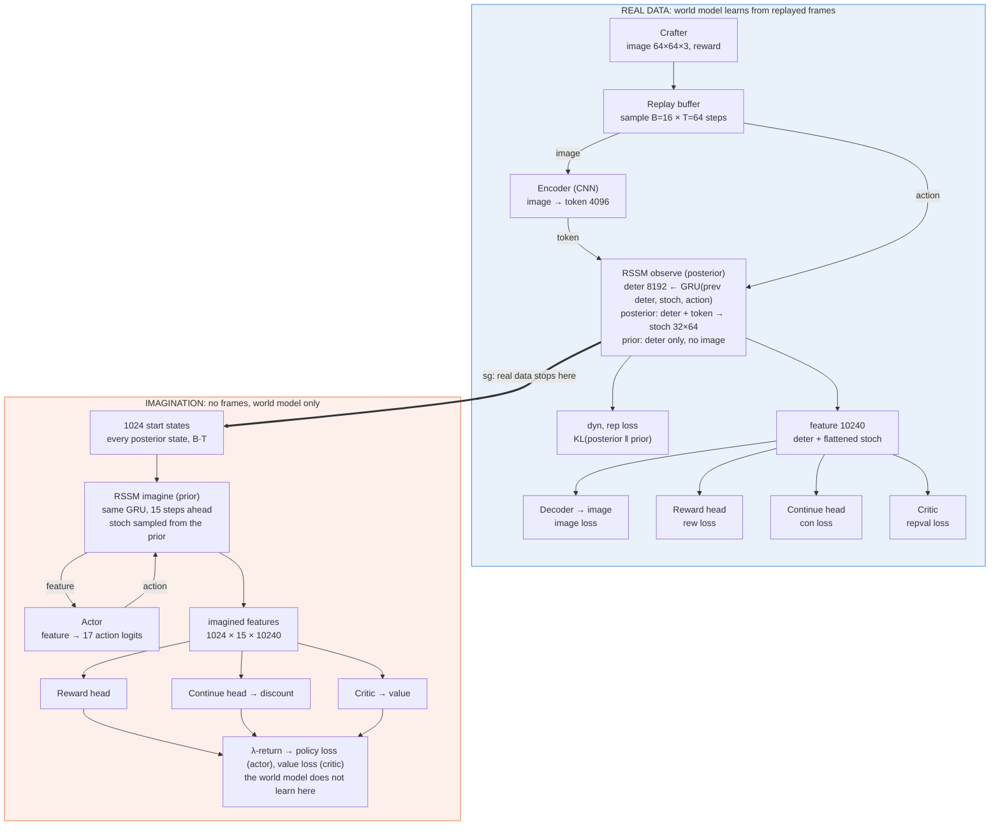
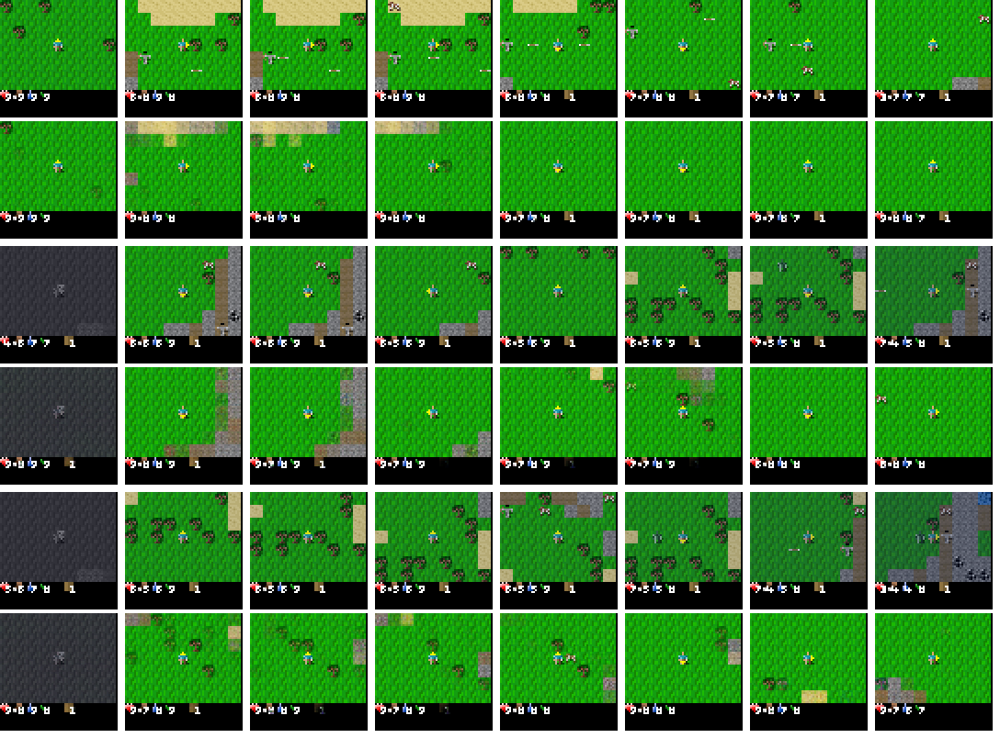

# DreamerV3 on Crafter: training, measuring and explaining a world model

Final technical report, TUKE MSc deep-learning group project
(deliverable 11). State on 2026-11-25, repository commit on `main`.
Every number below comes from a file under `runs/`; run IDs and job IDs
are in [`EXPERIMENTS.md`](../../EXPERIMENTS.md). Terms in *italics* are
defined in [`docs/glossary.md`](../glossary.md).

**Contents**

1. Summary
2. Background: world models
3. The model
4. Real experience and imagined rollouts
5. Setup and HPC workflow
6. Experiments
7. Results
8. Error analysis
9. Limitations
10. Conclusions
11. References
12. Appendix: how to rebuild every figure and table

## 1. Summary

We trained DreamerV3 (Hafner et al., 2025) on the Crafter benchmark
(Hafner, 2021) with the official `crafter` configuration, on one NVIDIA
H200 per run on the PERUN cluster. Six runs reached ~495k environment
steps: three seeds with the default imagination horizon of 15 steps and
three with a horizon of 5 (our sensitivity experiment). Then we looked
inside the world model: what it encodes, how well it predicts frames and
rewards without seeing the game, and where it fails.

Main findings:

- **The agent learns.** Crafter score rises from 1.4 % (random agent) to
  2.7 % (~50k steps), 4.3 % (~213k) and 11.3 ± 4.9 % (~495k, three
  seeds). Two of the three seeds (13.7 % and 14.4 %) are inside the
  paper's 14.5 ± 1.6 %, which the paper reaches with twice as many steps.
- **One seed got stuck** before stone tools (5.6 %). In Crafter one
  missed early step blocks every later achievement, so seeds spread
  widely.
- **The world model predicts the near future, then drifts.** Predicted
  frames are better than "repeat the last frame" from 7 steps ahead on,
  but the error triples in 32 steps and small objects (trees, cows)
  fade first.
- **Reward prediction is the weak point.** At ~213k the model predicts
  twice the real reward over 32-step windows; at ~495k it under-predicts
  and still never foresees health losses.
- **Horizon 5 vs 15.** A short horizon learns quick rewards first (ahead
  until ~300k steps, more zombie kills) but rarely reaches the longest
  chain (furnace 3 % vs 25 %). At ~495k the means are inside each
  other's spread; the two best agents use horizon 15.
- **The GPU is the bottleneck**: busy 87–89 % of the time in every
  production run, ~16 environment steps per second, ~9 h per 500k-step
  run.

## 2. Background: world models

A *world model* is a learned model of how an environment responds to
actions. Ha and Schmidhuber (2018) showed that an agent can learn a
compact model of a game from pixels and train a controller inside its
own "dream". LeCun (2022) argues that intelligent agents need models
that predict in an abstract representation space rather than in pixels,
because pixels contain much that cannot or need not be predicted. Our
open-loop results (section 8.1) show exactly this problem: pixel error
punishes the model for random noise it cannot know about, and rewards
blur.

Two recent surveys place this work:

- **General.** Ding et al. (2025) survey world models along two
  purposes: building an internal representation to *understand* the
  world, and *predicting* future states for decision making. DreamerV3
  does both: its latent state is a learned representation, and its
  dynamics model predicts the next latent state for planning-free policy
  learning.
- **Robotics and embodied AI.** Hou et al. (2026) and Li et al. (2025)
  survey world models for robot learning and embodied agents. In robotics,
  real interaction is slow, expensive and can break hardware, so learning
  behaviour inside a model (as DreamerV3 does) is attractive. Crafter is
  a cheap stand-in: it has partial observation, long chains of
  sub-goals and survival pressure, but every mistake costs only compute.

Other related surveys we used for background: Kirchner, Purschke and
Knoll (2026) on uncertainty in world models for physical AI, Guan et al.
(2024) on world models for autonomous driving, and Long et al. (2025).

**Team note.** Every member must have read at least the Ding et al.
and Hou et al. surveys before the defence and be able to say where
DreamerV3 sits in them.

## 3. The model

DreamerV3 has three parts that learn together: a **world model**, an
**actor** (the policy) and a **critic** (a value function). We run
upstream commit `e3f0224` unchanged (`upstream/`). Measured tensor
shapes and every line reference: [`docs/architecture.md`](../architecture.md).

### 3.1 Six things to keep apart

| Term | What it is in our run | Where it comes from |
|---|---|---|
| **Observation** | One 64×64 RGB frame from Crafter (plus the reward and episode flags) | The real game, through the replay buffer |
| **Latent state** | `deter` (8192 numbers, recurrent memory) + `stoch` (32 categorical variables with 64 classes each). Together the *feature*, 10240 numbers | The RSSM. With a real frame: the *posterior*. Without one: the *prior* |
| **Predicted next state** | The prior latent state at t+1, computed from the latent state at t and the action, without the frame at t+1 | RSSM `_core` + `_prior` |
| **Reward prediction** | A number per latent state: the reward the model expects for reaching that state | Reward head (`agent.py:57`) |
| **Imagined rollout** | A chain of 15 predicted latent states, each from the previous one and an action chosen by the actor. No frames, no game | RSSM `imagine` (`rssm.py:94`) |
| **Action** | One of 17 discrete Crafter actions (move, do, sleep, place, make ...) | In the real game: the actor on the posterior state of the live frame. In imagination: the actor on an imagined state |

The observation exists only on the real side. The predicted next state
and the imagined rollout exist only inside the model. The latent state,
reward prediction and action appear on both sides.

### 3.2 Components in the code

| Component (assignment wording) | Code | What it does |
|---|---|---|
| Representation model (encoder + posterior) | `upstream/dreamerv3/rssm.py:179` `Encoder`; posterior in `rssm.py:75` `_observe` | CNN turns the frame into a 4096-number token; the posterior combines it with `deter` to sample `stoch` |
| Recurrent state | `deter`, updated by `rssm.py:135` `_core` (block GRU, 8 blocks, 8192 units) | Memory of everything seen so far |
| Stochastic state | `stoch`, 32×64 one-hot, sampled in `_observe` (posterior) or `imagine` (prior) | What the model is unsure about at this step |
| Dynamics (transition) model | `_core` + `rssm.py:161` `_prior` | Predicts the next latent state from the current one and the action, without the image |
| Decoder | `rssm.py:253` `Decoder` | Feature back to an image; trains the representation through the `image` loss |
| Reward prediction | `agent.py:57` reward head | Feature to a reward (255-bin two-hot output) |
| Continuation prediction | `agent.py:58` continue head | Feature to the probability that the episode goes on (also carries the discount) |
| Actor | `agent.py:62` | Feature to 17 action logits |
| Critic | `agent.py:65`, slow copy `:66` | Feature to the expected λ-return |
| Losses | `agent.py:156` `Agent.loss` | All losses summed, one optimizer (`agent.py:76`) |

### 3.3 Architecture diagram

Data flow of one training step. Blue: the world model learns from real
replayed frames. Orange: imagination, where only the actor and critic
learn. The thick edge **sg** is the stop-gradient where real data ends
(`agent.py:196`). GitHub draws this diagram from the text.

### 3.4 Losses

| Loss | Side | Trains | Meaning |
|---|---|---|---|
| `image` | real | encoder, RSSM, decoder | Rebuild the real frame from the posterior latent state |
| `rew` | real | reward head, RSSM, encoder | Predict the real reward |
| `con` | real | continue head, RSSM, encoder | Predict whether the episode goes on |
| `dyn` | real | prior (dynamics) | KL(posterior ‖ prior), posterior frozen: learn to predict the next state without the frame |
| `rep` | real | posterior, encoder (scale 0.1) | Same KL, prior frozen: keep the representation predictable |
| `repval` | real | critic (and RSSM) | Critic error on real replayed states |
| `policy` | imagined | actor only | REINFORCE on the advantage, plus an entropy bonus |
| `value` | imagined | critic only | Critic error against the λ-return of the imagined rollout |

A KL below 1 nat gives no gradient (*free nats*), so a `dyn` curve at
1.0 means "prior and posterior agree", not "nothing learned".

## 4. Real experience and imagined rollouts

This separation is the core of the method and of this report.

**Real experience.** The agent plays Crafter with its current actor.
Each frame, action, reward and episode flag goes into the replay buffer.
The world model trains on batches of 16 replayed sequences of 64 steps
with the six "real" losses above. These are the only gradients that
change the encoder, RSSM, decoder, reward head and continue head (plus
`repval` for the critic). With `train_ratio 512`, each real step is
reused for about 512 replayed steps of training.

**Imagined rollouts.** Every posterior state of the batch (16 × 64 =
1024) becomes a start state. A stop-gradient (`sg`, `agent.py:196`)
cuts it off from the world model. From each start, the actor picks an
action, the RSSM predicts the next state with the prior, and this
repeats 15 times. The reward head, continue head and critic label every
imagined state. From these labels the λ-return (λ = 0.95, discount
≈ 0.997) is computed, and the actor and critic learn from it. No frame,
no encoder, no decoder, and no real reward is involved.

**Consequences.**

- The actor never sees a real reward. If the reward head is wrong, the
  actor learns the wrong thing (section 8.2).
- Rewards further than 15 imagined steps ahead reach the actor only
  through the critic's value of the last imagined state. This is what
  the sensitivity experiment changes (section 7.5).
- The world model does not learn from imagination, so a bad imagined
  rollout cannot make the model worse; it can only mislead the actor.

How the two sides compare in our main run (horizon 15 seed 0, mean of
the first 3 and last 10 log lines; `metrics.jsonl` and `scores.jsonl`):

| Quantity | ~3k steps | ~213k | ~495k |
|---|---|---|---|
| Imagined reward per step (`train/rew`) | 0.036 | 0.035 | 0.047 |
| Real reward per step (last 100 training episodes) | – | 0.022 | 0.045 |
| Actor entropy in imagination, nats (uniform: 2.83) | 1.18 | 0.19 | 0.28 |
| Critic value of imagined states | 1.33 | 1.65 | 2.43 |
| Mean continuation weight over 16 imagined steps | 0.93 | 0.95 | 0.95 |

At ~213k the model imagined 1.6 times more reward per step than the
agent got in the real game: it was optimistic. At ~495k imagined and
real reward per step agree (0.047 vs 0.045). The actor became nearly
deterministic early (entropy 0.19 nats) and stays so.

## 5. Setup and HPC workflow

### 5.1 Configuration

| Setting | Value |
|---|---|
| Code | `danijar/dreamerv3` commit `e3f0224`, unchanged |
| Config | `crafter` (`upstream/dreamerv3/configs.yaml`): RSSM `deter` 8192, `stoch` 32×64, `train_ratio` 512, batch 16 × 64, `imag_length` 15, `horizon` 333 (γ ≈ 0.997), λ 0.95 |
| Environment | Crafter, 1 environment, 64×64 frames, 17 actions |
| Budget | 500k env steps per run (paper: 1M), checkpoints every 15 min |
| Software | Docker image, Python 3.11, `jax[cuda]` 0.5.0; on the cluster the same image as an Apptainer `.sif` |
| Hardware | PERUN (TUKE): one NVIDIA H200 per run, SLURM |

### 5.2 Staged workflow

We followed the four stages of the assignment and never ran anything
heavy on the login node. All cluster actions went through
`scripts/perun.sh` from a laptop: a fixed set of commands (status, log,
fetch, submit, eval, ...) so that no free-form command reaches the
cluster. Details: [`docs/hpc.md`](../hpc.md), evidence:
[`docs/gpu-evidence.md`](../gpu-evidence.md).

| Stage | Script | Jobs | What it caught |
|---|---|---|---|
| 1. Local test | `scripts/check_local.py`, CPU debug run, in Docker | – | install problems before the cluster |
| 2. Interactive `srun` | `slurm/00_interactive.sh` | not recorded | (see gaps) |
| 3. Smoke test | `slurm/01_smoke.sbatch`, debug config | 148884, 172451 | 148884: upstream ignores `--run.duration`, the job hit its 30 min limit. Fixed with `--run.steps` |
| 4. Production | `slurm/02_train.sbatch`, `crafter` config | 172453, 173386, 172542, 173387, 173430–173433 | six runs to ~495k steps |
| Evaluation | `slurm/03_eval.sbatch` | 172543–172545, 173381, 175203–175208 | – |
| Open loop | `slurm/04_openloop.sbatch` | 172547, 172548, 175209 | 172547 crashed on GPU only (JAX transfer guard); fixed before the long runs needed it |

Both bugs appeared only on the cluster GPU, never on the laptop CPU.
The staged workflow caught them in short jobs.

**Reproducibility.** A fresh clone on 2026-11-25, following only
`README.md`, ran `./setup.sh` without failures and trained the CPU
debug config with checkpoints (ROADMAP week 8). Every run has a row in
`EXPERIMENTS.md` with its commit, flags and job ID, written before the
run started; failed runs keep their rows.

### 5.3 GPU use and wall-clock time

| Run | GPU busy | Env steps/s | Trained steps/s | Wall-clock to 500k |
|---|---|---|---|---|
| Horizon 15, seeds 0 / 1 / 2 | 88 / 88 / 89 % | 15.9 / 15.9 / 16.0 | ~8,150 | ~9 h |
| Horizon 5, seeds 0 / 1 / 2 | 87 / 88 / 87 % | 17.8 / 17.9 / 17.7 | ~9,100 | ~8 h |
| Smoke test (debug config) | 15 % | 181 | 1,448 | 11 min to 100k |

About 50 GPU-hours of training plus ~2 GPU-hours of evaluation and
open-loop jobs. With `train_ratio 512` the GPU, not the game, limits
speed, so we ran seeds in parallel instead of trying to speed up one
run. Horizon 5 is ~12 % faster because its imagined rollouts are 3 times
shorter; the world-model update is the same in both.

## 6. Experiments

| # | Experiment | Runs | Question |
|---|---|---|---|
| E1 | Horizon 15 (default), official config | `20261123-baseline-s0`, `20261124-baseline-s1`, `-s2` | Does DreamerV3 learn Crafter on our setup? |
| E2 | Reference agents | `20261124-eval-random`, `20261124-eval-early-s0` | Is the trained agent better than random and than an early checkpoint? |
| E3 | Open-loop prediction | `20261124-openloop-s0` (~213k), `20261125-openloop500k-s0` (~495k) | How far ahead can the world model predict frames, rewards and episode ends? |
| E4 | Sensitivity: imagination horizon | `20261124-imag5-s0`, `-s1`, `-s2` (`--agent.imag_length 5`, nothing else changed) | What does the horizon change in what the agent learns? |
| E5 | Evaluation of every checkpoint | `*-eval-*`, `*-eval500k-*` | Same 50 Crafter worlds (world seed 100), eval mode, `scripts/eval_agent.py` |

E1 and E4 both learn from real play and from imagination; they differ
only in the imagination length (15 or 5 steps). The E1 run IDs keep the
word `baseline` from before the sensitivity runs existed.

Crafter gives +1 the first time each of 22 achievements is unlocked in
an episode and ±0.1 per health point change. The *Crafter score* is the
geometric mean of the 22 success rates, so it rewards a wide spread of
achievements more than many of the easy ones.

## 7. Results

### 7.1 Return vs environment steps

Training return, mean of the last 50 episodes before each step count,
mean ± sd across 3 seeds:

| Env steps | Horizon 15 (default) | Horizon 5 |
|---|---|---|
| 100k | 3.51 ± 0.08 | 3.71 ± 0.39 |
| 213k | 4.33 ± 0.17 | 4.71 ± 0.75 |
| 300k | 5.55 ± 0.92 | 5.28 ± 0.79 |
| 400k | 6.63 ± 1.31 | 6.17 ± 0.53 |
| 500k | 7.87 ± 1.74 | 7.24 ± 0.10 |

Return still rises at 500k in every run: training was not finished.

### 7.2 Evaluation table

| System stage | Env steps | Episode return | Crafter score | Prediction evidence |
|---|---|---|---|---|
| Random agent | 0 | 1.52 ± 1.08 | 1.4 % | none |
| Early checkpoint | ~40–52k | 2.64 ± 1.37 | 2.7 % | not measured |
| Trained, seed 0 | ~213k | 4.44 ± 1.61 | 4.3 % | open-loop MSE 0.011 (1 step) to 0.032 (32 steps); reward 2× too high |
| Horizon 5, seed 0 | ~210k | 4.26 ± 1.29 | 3.4 % | not measured |
| Trained, 3 seeds | ~495k | 7.82 ± 1.65 | 11.3 ± 4.9 % | open-loop MSE 0.020 to 0.048 (night frames); reward 0.50 predicted vs 0.70 real |
| Horizon 5, 3 seeds | ~495k | 7.47 ± 0.31 | 9.4 ± 2.3 % | not measured |

± is across the 50 episodes for single agents and across seeds for the
three-seed rows. Per seed at ~495k: horizon 15 8.78 / 8.76 / 5.92 return,
13.7 / 14.4 / 5.6 % score; horizon 5 7.22 / 7.82 / 7.36, 7.8 / 12.0 /
8.4 %. Each stage beats the one before. At ~495k the agents also
survive longer than random (217 vs 175 steps per episode); at 213k
they did not yet.

What the agents learned at ~495k (success rate, horizon 15 mean over 3
seeds): collect wood 98 %, place table 96 %, collect drink 86 %, wood
pickaxe 63 %, collect stone 49 %, defeat zombie 35 %, place furnace
25 %, collect coal 17 %. Iron and diamond: never. Full table:
[`docs/results.md`](../results.md).

**Horizon 15 seed 2 is stuck one stage behind**: it makes a wood pickaxe
in 8 % of episodes (seeds 0 and 1: ~90 %), so it never mines stone, and
every later achievement stays at 0. Most of the spread across seeds
comes from this one run.

### 7.3 World-model losses

Mean of the first 3 and last 10 log lines, horizon 15 seed 0:

| Loss | ~3k steps | ~213k | ~495k |
|---|---|---|---|
| `image` | 89.8 | 3.59 | 3.52 |
| `rew` | 0.565 | 0.035 | 0.040 |
| `con` | 0.038 | 0.020 | 0.020 |
| `dyn` (KL, nats) | 4.19 | 2.01 | 2.34 |
| `value` (imagined) | 2.68 | 1.58 | 1.59 |

The image and reward losses fall by more than 10 times in the first
tens of thousands of steps, then stay flat. The KL between prior and
posterior stays above the free-nats floor of 1: the prior never fully
predicts what the frame adds. It rises slightly late in the run, when
the agent reaches night and caves (section 8.1); we did not test this
link.

### 7.4 Reward-prediction error

The `rew` loss above is measured on replayed real steps, one step at a
time, where the model sees the frame. The harder test is open loop
(section 8.2): the model sees 32 real frames, then predicts 32 steps of
reward from the actions alone.

| Checkpoint | Hit | False alarm | Missed | Neither | Mean reward per window, predicted / real |
|---|---|---|---|---|---|
| ~213k (30 windows) | 6 | 9 | 4 | 11 | 0.53 / 0.26 |
| ~495k (27 windows) | 6 | 6 | 7 | 8 | 0.50 / 0.70 |

"Achievement" = reward sum of at least 0.5 in the window.

### 7.5 Sensitivity: imagination horizon 15 vs 5

One flag changed (`--agent.imag_length 5`), same seeds, same budget,
same eval worlds.

| Eval at ~495k (50 worlds) | Horizon 15 | Horizon 5 |
|---|---|---|
| Return, mean ± sd across seeds | 7.82 ± 1.65 | 7.47 ± 0.31 |
| Crafter score | 11.3 ± 4.9 % | 9.4 ± 2.3 % |
| Score per seed | 13.7 / 14.4 / 5.6 % | 7.8 / 12.0 / 8.4 % |
| Defeat zombie | 35 % | 57 % |
| Place furnace | 25 % | 3 % |
| Wood pickaxe | 63 % (seed 2: 8 %) | 79 % |
| Env steps per second | 15.9 | 17.8 |

- **Early, horizon 5 is ahead** (100k and 213k); from ~300k horizon 15
  is.
- **At ~495k the means are inside each other's spread.** With 3 seeds
  we cannot call one setting better on average.
- **The best agents use horizon 15** (13.7 and 14.4 %); no horizon-5
  seed passes 12.0 %.
- **Horizon 5 is more consistent** (return sd 0.31 vs 1.65), kills more
  zombies (a reward that comes within a few steps), and rarely builds a
  furnace (the longest chain the agents reach: wood, table, pickaxe,
  stone, then the furnace).
- **The short horizon delays long chains; it does not block them.** At
  213k horizon 5 never made a wood pickaxe (0 of 50 episodes); at ~495k
  all its seeds do (72–88 %).

**Interpretation.** With a 5-step rollout, a reward 10 steps away
reaches the actor only through the critic's estimate at the end of the
rollout, not as an imagined reward. Rewards that come within 5 steps
are learned directly and early. This matches what we see, but we did
not test it directly (for example by measuring how far ahead each
setting's rewards come).

### 7.6 Comparison with the published result

| | Env steps | Seeds | Crafter score | Return |
|---|---|---|---|---|
| Paper, DreamerV3 (arXiv 2301.04104 v1, Table M.1) | 1M | 10 | 14.5 ± 1.6 % | 11.7 ± 1.9 |
| Paper, random | – | 10 | 1.6 % | 2.1 ± 1.3 |
| Ours, DreamerV3 | ~495k | 3 | 11.3 ± 4.9 % | 7.82 ± 1.65 |
| Ours, seeds 0 and 1 | ~495k | 2 | 13.7 / 14.4 % | 8.78 / 8.76 |
| Ours, random | – | 50 episodes | 1.4 % | 1.52 ± 1.08 |

Our random agent matches the paper's, so our evaluation and score
formula behave like theirs. Two of three trained seeds reach the
paper's score with half its steps; the mean is lower because of the
stuck seed. Remaining differences: half the steps, 3 instead of 10
seeds, 50 eval episodes of one checkpoint instead of all training
episodes, and 2024 code instead of the paper's 2023 code.

## 8. Error analysis

Full analysis: [`docs/failures.md`](../failures.md).

### 8.1 Frames: the model forgets details first

Open-loop test: 32 real context frames, then 32 frames predicted from
the actions alone, on the same 10 worlds (seed 100). Pixel MSE per step
ahead, against a trivial baseline that repeats the last real frame:

| Steps ahead | 1 | 2 | 4 | 8 | 16 | 32 |
|---|---|---|---|---|---|---|
| World model, ~213k | 0.011 | 0.012 | 0.018 | 0.023 | 0.027 | 0.032 |
| Copy last frame, ~213k | 0.006 | 0.009 | 0.015 | 0.030 | 0.037 | 0.034 |
| World model, ~495k | 0.020 | 0.021 | 0.023 | 0.029 | 0.040 | 0.048 |
| Copy last frame, ~495k | 0.007 | 0.010 | 0.016 | 0.029 | 0.033 | 0.038 |

Three windows at ~213k. In each pair of rows: real frame (top) and the
model's frame (bottom). The first two columns are context steps (the
model sees the real frame); the other columns are open loop, 1 to 32
steps after the last real frame.

- **Errors add up.** Each imagined step starts from the previous
  imagined state, with no real frame to correct it. The error triples
  in 32 steps at ~213k.
- **Copying wins for the first 6 steps.** The scene barely changes in a
  few steps, and the decoder blurs even with the real frame (MSE 0.008
  in context). From step 7 the model wins: it knows how the view moves
  when the player walks.
- **Small and rare things fade first**: trees, sand edges, cows. The
  player and large terrain stay. These small objects are what
  achievements need.
- **The ~495k numbers are not worse modelling.** The 495k agent
  survives longer, so its windows reach night and caves. Crafter draws
  night darker and adds random noise, which no model can predict pixel
  by pixel. The two tests see different frames; a fair comparison would
  replay the same recorded episodes through both checkpoints (not done).
  This is the problem LeCun (2022) describes: a pixel loss demands
  details that cannot be predicted.

### 8.2 Rewards: false alarms, then misses

- **~213k: over-prediction.** 9 false alarms in 30 windows; the model
  predicts a full +1 where nothing happens. Possible causes (not
  tested): the imagined world drifts from the real one, or the model
  does not track which achievements were already unlocked (+1 is paid
  only the first time).
- **~495k: under-prediction.** The agent unlocks more per window (0.70
  real) and the model misses 7 of 13 real achievement windows.
- **Health losses are never foreseen.** Windows where the real reward
  sum is negative (damage from hunger, thirst or zombies) get positive
  predictions at both checkpoints (+0.24 and +0.93).

Why it matters: the actor learns only from imagined rewards (section 4).
False alarms push it toward actions that pay nothing; missed rewards
and missed damage hide what it should learn or avoid.

### 8.3 Episode ends: untested

The continue head predicts ≥ 0.96 at every open-loop step, and no
window contains a death (episodes last 56–430 steps, windows 64). This
is a gap in our test, not evidence that the head predicts death well.

### 8.4 Run failures

| What failed | Cause | Fix |
|---|---|---|
| Smoke job killed at its time limit | upstream `e3f0224` ignores `--run.duration` | `--run.steps 100000` |
| Open-loop job 172547 crashed on GPU only | JAX transfer guard refuses an implicit GPU-to-host copy | explicit `jax.device_get` |
| Baseline stopped at 213k | project time budget | resumed with the same run ID to 500k |
| `env.txt` of every PERUN job up to 175209 shows the host's Python | `SIF` not exported in `slurm/common.sh` | exported (PR #62); real versions are the image's |

## 9. Limitations

- **Budget.** ~495k of the paper's 1M steps, 3 of its 10 seeds. One
  stuck seed moves the mean by 3 points.
- **Evaluation protocol.** 50 eval-mode episodes on fixed worlds from one
  checkpoint, not the benchmark's success rates over all training
  episodes. The training return over the last 50 episodes (7.87) is close
  to the eval return (7.82), so the gap is likely small.
- **Open-loop test.** One seed, 27–30 windows per checkpoint: the counts
  are examples, not rates. Pixel MSE rewards blur and ignores small
  important objects. The 213k and 495k tests see different episodes.
  No death occurs inside a window.
- **Sensitivity explanation not tested.** The horizon effect follows
  from how imagination training works; we did not measure it directly.
- **Interactive stage not recorded.** No `srun` session of stage 2 was
  registered, and `sacct` was not reachable, so wall-clock times come
  from job logs.
- **Fresh clone on the same laptop.** The reproducibility check used a
  new clone and the README only, but the same machine with Docker's
  image cache.

## 10. Conclusions

- DreamerV3 with the official configuration learns Crafter on our
  setup: from 1.4 % (random) to 11.3 % mean Crafter score at half the
  paper's steps, with two seeds at the paper's level.
- Real experience trains only the world model; imagined rollouts train
  only the actor and critic. We showed this split in the code
  (stop-gradient at `agent.py:196`) and in the logs (section 4).
- The world model predicts the next few steps well and the general
  layout for 32 steps, but loses small objects first and predicts
  reward unreliably over long windows. Its reward errors go straight
  into the actor's training signal.
- The imagination horizon trades early, consistent learning of quick
  rewards (horizon 5) against reaching longer achievement chains
  (horizon 15). With 3 seeds the average difference at ~495k is not
  reliable.
- Next steps, in order of value: replay the same recorded episodes
  through both checkpoints; test episode ends in open loop; more seeds;
  train to 1M steps (~9 h more per run).

**The goal of this project was to demonstrate, measure and explain
imagination-based control, not to reach the highest score.**

## 11. References

World-model surveys:

- Ding, J., et al. (2025). Understanding World or Predicting Future? A
  Comprehensive Survey of World Models. *ACM Computing Surveys*, 58(3),
  1–38. https://doi.org/10.1145/3746449 (general survey)
- Hou, B., et al. (2026). World Model for Robot Learning: A
  Comprehensive Survey. arXiv:2605.00080. (robotics survey)
- Li, X., et al. (2025). A Comprehensive Survey on World Models for
  Embodied AI. arXiv:2510.16732. (embodied-AI survey)
- Kirchner, Purschke, and Knoll (2026). A survey of world models for
  physical AI with uncertainty representation and control. *Discover
  Artificial Intelligence*, 6, 1037. https://doi.org/10.1007/s44163-026-02122-1
- Guan, Y., et al. (2024). World models for autonomous driving: an
  initial survey. *IEEE Transactions on Intelligent Vehicles*.
  https://doi.org/10.1109/TIV.2024.3398357
- Long, X., et al. (2025). arXiv:2507.00917.

Methods and environment:

- Hafner, D., Pasukonis, J., Ba, J., and Lillicrap, T. (2025). Mastering
  diverse control tasks through world models. *Nature*.
  https://doi.org/10.1038/s41586-025-08744-2
- Hafner, D., et al. (2023). Mastering Diverse Domains through World
  Models. arXiv:2301.04104 (v1: Crafter table M.1).
- Hafner, D. (2021). Benchmarking the Spectrum of Agent Capabilities
  (Crafter). arXiv:2109.06780. https://github.com/danijar/crafter
- Ha, D., and Schmidhuber, J. (2018). World Models.
  https://worldmodels.github.io/
- LeCun, Y. (2022). A Path Towards Autonomous Machine Intelligence.
  https://openreview.net/forum?id=BZ5a1r-kVsf
- Code: https://github.com/danijar/dreamerv3, commit `e3f0224`.

## 12. Appendix: how to rebuild every figure and table

Run in the Docker shell (`docker compose --profile cpu run --rm
train-cpu bash`) or with any Python 3; all scripts use the standard
library only.

| Figure / table | Command |
|---|---|
| Section 4 and 7.3 figures | `python analysis/plot_curves.py 20261123-baseline-s0` |
| Section 7.1 figure | `analysis/compare_runs.py`, command in [`docs/results.md`](../results.md) |
| Section 5.3 figure and table | `python analysis/gpu_usage.py 20261123-baseline-s0 20261124-imag5-s0 ...` ([`docs/gpu-evidence.md`](../gpu-evidence.md)) |
| Sections 7.4 and 8 | `python analysis/failures.py 20261124-openloop-s0` and `20261125-openloop500k-s0` |
| Evaluation tables | `scripts/eval_agent.py` on PERUN (`slurm/03_eval.sbatch`), then `runs/*-eval*/` |
| Tensor shapes (section 3) | `python analysis/trace_batch.py` (Docker, CPU) |
