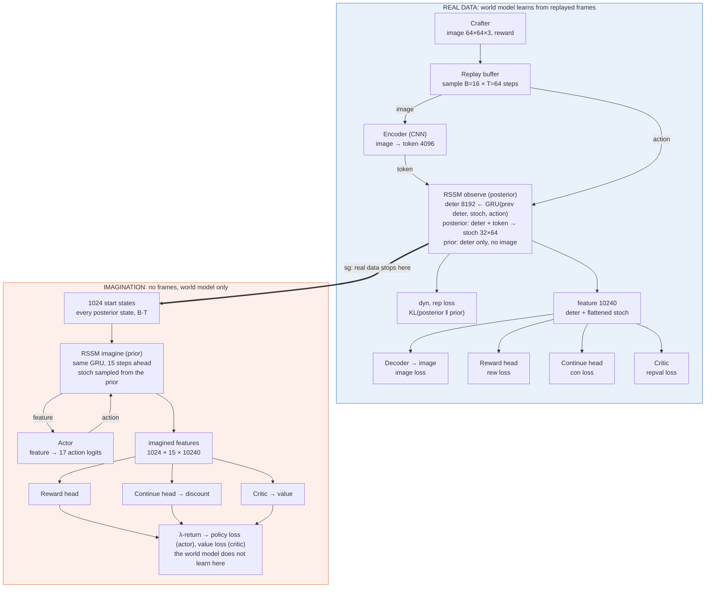

# DreamerV3 on Crafter: training, measuring and explaining a world model

Final technical report, TUKE MSc deep-learning group project
(deliverable 11). State on 2026-11-26, repository commit on `main`.
Every number below comes from a file under `runs/`; run IDs and job IDs
are in [`EXPERIMENTS.md`](../../EXPERIMENTS.md). Terms in *italics* are
defined in [`docs/glossary.md`](../glossary.md).

**Contents**

1. Summary
2. Background: world models
3. The model
4. Real experience and imagined rollouts
5. Setup and HPC workflow
6. Experiments
7. Results
8. Error analysis
9. Limitations
10. Conclusions
11. References
12. Appendix: how to rebuild every figure and table

## 1. Summary

We trained DreamerV3 (Hafner et al., 2025) on the Crafter benchmark
(Hafner, 2021) with the official `crafter` configuration, on one NVIDIA
H200 per run on the PERUN cluster. Nine runs reached ~960k environment
steps (of the planned 1M; an out-of-memory kill stopped them): three
seeds each with the default imagination horizon of 15 steps, a horizon
of 5 and a horizon of 30 (our sensitivity experiment). Then we looked
inside the world model: what it encodes, how well it predicts frames and
rewards without seeing the game, and where it fails.

Main findings:

- The agent learns. Its Crafter score rises from 1.4 % (random agent) to
  2.7 % (~50k steps), 4.3 % (~213k), 11.3 ± 4.9 % (~495k) and
  23.0 ± 1.0 % (~960k, three seeds). The final return, 11.56 ± 0.11,
  matches the paper's 11.7 ± 1.9. Our score is above the paper's
  14.5 %, most likely because we score the final agent only while the
  benchmark averages over all training episodes.
- Seeds can get stuck and then recover. At ~495k one seed was stuck
  before stone tools (5.6 %): in Crafter one missed early step blocks
  every later achievement. By ~960k it had caught up; the three seeds
  are within 0.2 return.
- The world model predicts the near future, then drifts. Predicted
  frames beat "repeat the last frame" from step 7 on at ~213k, but
  only from step 7 to 12 at ~960k; the error more than doubles in 32
  steps and small objects (trees, cows) fade first.
- Reward prediction is the weak point. At ~213k the model predicts
  twice the real reward over 32-step windows; at ~495k and ~960k it
  under-predicts and still never foresees health losses.
- Of horizons 5, 15 and 30, the default 15 ends best (score 23.0 %,
  return 11.56); horizon 30 learns fastest until ~600k steps, then falls
  behind (20.1 %); horizon 5 ends last (18.2 %) and rarely builds a
  furnace, the longest chain. Every horizon 15 seed beats every seed of
  the other two settings on return.
- The GPU limits speed. It is busy 84–89 % of the time in every
  production run, at ~16 environment steps per second, ~9 h per 500k
  steps. Host RAM grows with the replay buffer by ~6 GB per 100k steps,
  and that stopped the runs before 1M.

## 2. Background: world models

A *world model* is a learned model of how an environment responds to
actions. Ha and Schmidhuber (2018) showed that an agent can learn a
compact model of a game from pixels and train a controller inside its
own "dream". LeCun (2022) argues that intelligent agents need models
that predict in an abstract representation space rather than in pixels,
because pixels contain much that cannot or need not be predicted. Our
open-loop results (section 8.1) show this problem: pixel error
punishes the model for random noise it cannot know about, and rewards
blur.

Two recent surveys place this work:

- General: Ding et al. (2025) survey world models along two
  purposes: building an internal representation to *understand* the
  world, and *predicting* future states for decision making. DreamerV3
  does both: its latent state is a learned representation, and its
  dynamics model predicts the next latent state for planning-free policy
  learning.
- Robotics and embodied AI: Hou et al. (2026) and Li et al. (2025)
  survey world models for robot learning and embodied agents. In robotics,
  real interaction is slow, expensive and can break hardware, so learning
  behaviour inside a model (as DreamerV3 does) is attractive. Crafter is
  a cheap stand-in: it has partial observation, long chains of
  sub-goals and survival pressure, but every mistake costs only compute.

Other related surveys we used for background: Kirchner, Purschke and
Knoll (2026) on uncertainty in world models for physical AI, Guan et al.
(2024) on world models for autonomous driving, and Long et al. (2025)
on learning embodied agents from simulators and world models.

## 3. The model

DreamerV3 has three parts that learn together: a **world model**, an
**actor** (the policy) and a **critic** (a value function). We run
upstream commit `e3f0224` unchanged (`upstream/`). Measured tensor
shapes and every line reference: [`docs/architecture.md`](../architecture.md).

### 3.1 Six things to keep apart

| Term | What it is in our run | Where it comes from |
|---|---|---|
| **Observation** | One 64×64 RGB frame from Crafter (plus the reward and episode flags) | The real game, through the replay buffer |
| **Latent state** | `deter` (8192 numbers, recurrent memory) + `stoch` (32 categorical variables with 64 classes each). Together the *feature*, 10240 numbers | The RSSM. With a real frame: the *posterior*. Without one: the *prior* |
| **Predicted next state** | The prior latent state at t+1, computed from the latent state at t and the action, without the frame at t+1 | RSSM `_core` + `_prior` |
| **Reward prediction** | A number per latent state: the reward the model expects for reaching that state | Reward head (`agent.py:57`) |
| **Imagined rollout** | A chain of 15 predicted latent states, each from the previous one and an action chosen by the actor. No frames, no game | RSSM `imagine` (`rssm.py:94`) |
| **Action** | One of 17 discrete Crafter actions (move, do, sleep, place, make ...) | In the real game: the actor on the posterior state of the live frame. In imagination: the actor on an imagined state |

The observation exists only on the real side. The predicted next state
and the imagined rollout exist only inside the model. The latent state,
reward prediction and action appear on both sides.

### 3.2 Components in the code

| Component (assignment wording) | Code | What it does |
|---|---|---|
| Representation model (encoder + posterior) | `upstream/dreamerv3/rssm.py:179` `Encoder`; posterior in `rssm.py:75` `_observe` | CNN turns the frame into a 4096-number token; the posterior combines it with `deter` to sample `stoch` |
| Recurrent state | `deter`, updated by `rssm.py:135` `_core` (block GRU, 8 blocks, 8192 units) | Memory of everything seen so far |
| Stochastic state | `stoch`, 32×64 one-hot, sampled in `_observe` (posterior) or `imagine` (prior) | What the model is unsure about at this step |
| Dynamics (transition) model | `_core` + `rssm.py:161` `_prior` | Predicts the next latent state from the current one and the action, without the image |
| Decoder | `rssm.py:253` `Decoder` | Feature back to an image; trains the representation through the `image` loss |
| Reward prediction | `agent.py:57` reward head | Feature to a reward (255-bin two-hot output) |
| Continuation prediction | `agent.py:58` continue head | Feature to the probability that the episode goes on (also carries the discount) |
| Actor | `agent.py:62` | Feature to 17 action logits |
| Critic | `agent.py:65`, slow copy `:66` | Feature to the expected λ-return |
| Losses | `agent.py:156` `Agent.loss` | All losses summed, one optimizer (`agent.py:76`) |

### 3.3 Architecture diagram

Data flow of one training step. Blue: the world model learns from real
replayed frames. Orange: imagination, where only the actor and critic
learn. The thick edge **sg** is the stop-gradient where real data ends
(`agent.py:196`). GitHub draws this diagram from the text.

### 3.4 Losses

| Loss | Side | Trains | Meaning |
|---|---|---|---|
| `image` | real | encoder, RSSM, decoder | Rebuild the real frame from the posterior latent state |
| `rew` | real | reward head, RSSM, encoder | Predict the real reward |
| `con` | real | continue head, RSSM, encoder | Predict whether the episode goes on |
| `dyn` | real | prior (dynamics) | KL(posterior ‖ prior), posterior frozen: learn to predict the next state without the frame |
| `rep` | real | posterior, encoder (scale 0.1) | Same KL, prior frozen: keep the representation predictable |
| `repval` | real | critic (and RSSM) | Critic error on real replayed states |
| `policy` | imagined | actor only | REINFORCE on the advantage, plus an entropy bonus |
| `value` | imagined | critic only | Critic error against the λ-return of the imagined rollout |

A KL below 1 nat gives no gradient (*free nats*), so a `dyn` curve at
1.0 means "prior and posterior agree", not "nothing learned".

## 4. Real experience and imagined rollouts

**Real experience.** The agent plays Crafter with its current actor.
Each frame, action, reward and episode flag goes into the replay buffer.
The world model trains on batches of 16 replayed sequences of 64 steps
with the six "real" losses above. These are the only gradients that
change the encoder, RSSM, decoder, reward head and continue head (plus
`repval` for the critic). With `train_ratio 512`, each real step is
reused for about 512 replayed steps of training.

**Imagined rollouts.** Every posterior state of the batch (16 × 64 =
1024) becomes a start state. A stop-gradient (`sg`, `agent.py:196`)
cuts it off from the world model. From each start, the actor picks an
action, the RSSM predicts the next state with the prior, and this
repeats 15 times. The reward head, continue head and critic label every
imagined state. From these labels the λ-return (λ = 0.95, discount
≈ 0.997) is computed, and the actor and critic learn from it. No frame,
no encoder, no decoder, and no real reward is involved.

Three consequences follow:

- The actor never sees a real reward. If the reward head is wrong, the
  actor learns the wrong thing (section 8.2).
- Rewards further than 15 imagined steps ahead reach the actor only
  through the critic's value of the last imagined state. This is what
  the sensitivity experiment changes (section 7.5).
- The world model does not learn from imagination, so a bad imagined
  rollout cannot make the model worse; it can only mislead the actor.

How the two sides compare in our main run (horizon 15 seed 0, mean of
the first 3 and last 10 log lines; `metrics.jsonl` and `scores.jsonl`):

| Quantity | ~3k steps | ~213k | ~495k | ~960k |
|---|---|---|---|---|
| Imagined reward per step (`train/rew`) | 0.036 | 0.035 | 0.047 | 0.059 |
| Real reward per step (last 100 training episodes) | – | 0.022 | 0.045 | 0.048 |
| Actor entropy in imagination, nats (uniform: 2.83) | 1.18 | 0.19 | 0.28 | 0.30 |
| Critic value of imagined states | 1.33 | 1.65 | 2.43 | 3.19 |
| Mean continuation weight over 16 imagined steps | 0.93 | 0.95 | 0.95 | 0.95 |

At ~213k the model imagined 1.6 times more reward per step than the
agent got in the real game: it was optimistic. At ~495k imagined and
real reward per step agree (0.047 vs 0.045). At ~960k imagination is
optimistic again, 1.2 times the real reward (0.059 vs 0.048): imagined
reward keeps rising while the real one levels off. The open-loop test
at ~960k points the other way (predicted reward per window too low,
section 7.4); it uses recorded actions, while `train/rew` uses the
actor's own imagined actions, so the two need not agree. The actor
became nearly deterministic early (entropy 0.19 nats) and stays so.

## 5. Setup and HPC workflow

### 5.1 Configuration

| Setting | Value |
|---|---|
| Code | `danijar/dreamerv3` commit `e3f0224`, unchanged |
| Config | `crafter` (`upstream/dreamerv3/configs.yaml`): RSSM `deter` 8192, `stoch` 32×64, `train_ratio` 512, batch 16 × 64, `imag_length` 15, `horizon` 333 (γ ≈ 0.997), λ 0.95 |
| Environment | Crafter, 1 environment, 64×64 frames, 17 actions |
| Budget | 500k env steps per run first, then resumed towards 1M (paper: 1M); stopped at 956k–979k by an out-of-memory kill. Checkpoints every 15 min |
| Software | Docker image, Python 3.11, `jax[cuda]` 0.5.0; on the cluster the same image as an Apptainer `.sif` |
| Hardware | PERUN (TUKE): one NVIDIA H200 per run, SLURM |

### 5.2 Staged workflow

We followed the four stages of the assignment and never ran anything
heavy on the login node. All cluster actions went through
`scripts/perun.sh` from a laptop: a fixed set of commands (status, log,
fetch, submit, eval, ...) so that no free-form command reaches the
cluster. Details: [`docs/hpc.md`](../hpc.md), evidence:
[`docs/gpu-evidence.md`](../gpu-evidence.md).

| Stage | Script | Jobs | What it caught |
|---|---|---|---|
| 1. Local test | `scripts/check_local.py`, CPU debug run, in Docker | – | install problems before the cluster |
| 2. Interactive `srun` | `slurm/00_interactive.sh` | not recorded | (see gaps) |
| 3. Smoke test | `slurm/01_smoke.sbatch`, debug config | 148884, 172451 | 148884: upstream ignores `--run.duration`, the job hit its 30 min limit. Fixed with `--run.steps` |
| 4. Production | `slurm/02_train.sbatch`, `crafter` config | 172453, 173386, 172542, 173387, 173430–173433; 175280, 175282, 175283, 175290–175292, 175295–175297 | six runs to ~495k steps; then all six resumed and three horizon 30 runs, to ~960k. All nine 1M jobs were killed for exceeding 64 GB of RAM while saving a checkpoint |
| Evaluation | `slurm/03_eval.sbatch` | 172543–172545, 173381, 175203–175208, 176615–176622, 176678 | – |
| Open loop | `slurm/04_openloop.sbatch` | 172547, 172548, 175209, 176679 | 172547 crashed on GPU only (JAX transfer guard); fixed before the long runs needed it |

Both bugs appeared only on the cluster GPU, and the staged workflow
caught them in short jobs before any long run depended on them.

**Reproducibility.** A fresh clone on 2026-11-25, following only
`README.md`, ran `./setup.sh` without failures and trained the CPU
debug config with checkpoints. Every run has a row in
`EXPERIMENTS.md` with its commit, flags and job ID, written before the
run started; failed runs keep their rows.

Checkpoints are not in the repository: they are too large for git and
for the 5 MB file check. Each run's `ckpt` (last save, ~960k) and the
early copies `ckpt_early_<step>` stay on the PERUN scratch storage under
`/mnt/scratch/<user>/dreamer/logdir/<run-id>/`. That storage deletes
files 60 days after their last access, so they must be copied elsewhere
if they are needed after the project.

### 5.3 GPU use and wall-clock time

Measured over each whole run, up to ~960k steps
([`gpu-evidence.md`](../gpu-evidence.md)).

| Run | GPU busy | Env steps/s | Trained steps/s | Time per 500k steps |
|---|---|---|---|---|
| Horizon 15, seeds 0 / 1 / 2 | 85 / 88 / 88 % | 15.9 / 16.0 / 16.0 | ~8,200 | ~9 h |
| Horizon 5, seeds 0 / 1 / 2 | 84 / 85 / 87 % | 17.8 / 17.8 / 17.7 | ~9,100 | ~8 h |
| Horizon 30, seeds 0 / 1 / 2 | 89 / 89 / 88 % | 13.9 / 13.9 / 13.9 | ~7,100 | ~10 h |
| Smoke test (debug config) | 15 % | 181 | 1,448 | 11 min to 100k |

About 150 GPU-hours of training plus ~3 GPU-hours of evaluation,
open-loop and video jobs. With `train_ratio 512` the GPU, not the game,
limits speed, so we ran seeds in parallel instead of trying to speed up
one run. Horizon 5 is ~12 % faster and horizon 30 ~13 % slower than
horizon 15: only the imagined rollouts change length; the world-model
update is the same in all three.

Host RAM grows with the run: the replay buffer keeps every real step
(`replay.size` 5e6), about 6 GB per 100k steps, 58–59 GB at ~960k. A
checkpoint save on top passed the job's `--mem=64G`, and SLURM killed
all nine runs there (section 8.5). A full 1M run needs about 70 GB.

## 6. Experiments

| # | Experiment | Runs | Question |
|---|---|---|---|
| E1 | Horizon 15 (default), official config | `20261123-baseline-s0`, `20261124-baseline-s1`, `-s2` | Does DreamerV3 learn Crafter on our setup? |
| E2 | Reference agents | `20261124-eval-random`, `20261124-eval-early-s0` | Is the trained agent better than random and than an early checkpoint? |
| E3 | Open-loop prediction | `20261124-openloop-s0` (~213k), `20261125-openloop500k-s0` (~495k), `20261126-openloop1m-s0` (~960k) | How far ahead can the world model predict frames, rewards and episode ends? |
| E4 | Sensitivity: imagination horizon | `20261124-imag5-s0`, `-s1`, `-s2` (`--agent.imag_length 5`) and `20261125-imag30-s0`, `-s1`, `-s2` (`--agent.imag_length 30`); nothing else changed | What does the horizon change in what the agent learns? |
| E5 | Evaluation of every checkpoint | `*-eval-*`, `*-eval500k-*`, `*-eval1m-*` | Same 50 Crafter worlds (world seed 100), eval mode, `scripts/eval_agent.py` |

E1 and E4 all learn from real play and from imagination; they differ
only in the imagination length (15, 5 or 30 steps). The E1 run IDs keep the
word `baseline` from before the sensitivity runs existed.

Crafter gives +1 the first time each of 22 achievements is unlocked in
an episode and ±0.1 per health point change. The *Crafter score* is the
geometric mean of the 22 success rates, so it rewards a wide spread of
achievements more than many of the easy ones.

## 7. Results

### 7.1 Return vs environment steps

Training return, mean of the last 50 episodes before each step count,
mean ± sd across 3 seeds:

| Env steps | Horizon 15 (default) | Horizon 5 | Horizon 30 |
|---|---|---|---|
| 100k | 3.51 ± 0.08 | 3.71 ± 0.39 | 3.76 ± 0.05 |
| 213k | 4.33 ± 0.17 | 4.71 ± 0.75 | 5.37 ± 0.34 |
| 300k | 5.55 ± 0.92 | 5.28 ± 0.79 | 6.48 ± 0.10 |
| 400k | 6.63 ± 1.31 | 6.17 ± 0.53 | 7.75 ± 0.11 |
| 500k | 7.73 ± 1.85 | 7.25 ± 0.29 | 9.08 ± 0.40 |
| 600k | 9.22 ± 0.45 | 8.41 ± 0.41 | 9.54 ± 0.42 |
| 700k | 9.86 ± 0.14 | 9.13 ± 0.38 | 9.77 ± 0.25 |
| 800k | 10.98 ± 0.35 | 9.57 ± 1.17 | 10.35 ± 0.83 |
| 900k | 11.38 ± 0.35 | 9.95 ± 0.76 | 10.69 ± 0.35 |
| 950k | 11.45 ± 0.18 | 10.03 ± 0.62 | 11.09 ± 0.35 |

Return still rises at 950k, but slowly: +0.07 for horizon 15 since
900k. The runs stopped at 956k–979k steps (out-of-memory kill while
saving a checkpoint, section 8.5).

Episode length (second chart; mean of the last 50 training episodes,
mean ± sd across seeds) grows much less than the return:

| Env steps | Horizon 15 | Horizon 5 | Horizon 30 |
|---|---|---|---|
| 50k | 177 ± 5 | 178 ± 4 | 173 ± 4 |
| 500k | 217 ± 15 | 208 ± 6 | 212 ± 11 |
| 950k | 226 ± 25 | 209 ± 11 | 229 ± 7 |

From 500k to 950k the return of horizon 15 rises by half (7.73 to
11.45) while its episodes get only ~4 % longer. The agent improves by
unlocking more achievements per episode, not by surviving longer. Every
episode still ends in death; none reaches Crafter's 10,000-step limit.

### 7.2 Evaluation table

| System stage | Env steps | Episode return | Crafter score | Prediction evidence |
|---|---|---|---|---|
| Random agent | 0 | 1.52 ± 1.08 | 1.4 % | none |
| Early checkpoint | ~40–52k | 2.64 ± 1.37 | 2.7 % | not measured |
| Trained, seed 0 | ~213k | 4.44 ± 1.61 | 4.3 % | open-loop MSE 0.011 (1 step) to 0.032 (32 steps); reward 2× too high |
| Horizon 5, seed 0 | ~210k | 4.26 ± 1.29 | 3.4 % | not measured |
| Trained, 3 seeds | ~495k | 7.82 ± 1.65 | 11.3 ± 4.9 % | open-loop MSE 0.020 to 0.048 (night frames); reward 0.50 predicted vs 0.70 real |
| Horizon 5, 3 seeds | ~495k | 7.47 ± 0.31 | 9.4 ± 2.3 % | not measured |
| **Trained, 3 seeds (final)** | ~960k | **11.56 ± 0.11** | **23.0 ± 1.0 %** | open-loop MSE 0.018 to 0.042; reward 1.08 predicted vs 1.35 real |
| Horizon 5, 3 seeds | ~960k | 10.03 ± 0.76 | 18.2 ± 5.0 % | not measured |
| Horizon 30, 3 seeds | ~960k | 10.84 ± 0.42 | 20.1 ± 0.7 % | not measured |

± is across the 50 episodes for single agents and across seeds for the
three-seed rows. Per seed at ~495k: horizon 15 8.78 / 8.76 / 5.92 return,
13.7 / 14.4 / 5.6 % score; horizon 5 7.22 / 7.82 / 7.36, 7.8 / 12.0 /
8.4 %. Per seed at ~960k: horizon 15 11.64 / 11.44 / 11.60 return,
23.5 / 21.9 / 23.6 % score. Each horizon 15 stage beats the one before.
Survival grows more slowly: at 213k the agent lived no longer than the
random one (176 steps per episode), at ~495k 217 steps, at ~960k 225.

What the agents learned at ~495k (success rate, horizon 15 mean over 3
seeds): collect wood 98 %, place table 96 %, collect drink 86 %, wood
pickaxe 63 %, collect stone 49 %, defeat zombie 35 %, place furnace
25 %, collect coal 17 %. Iron and diamond: never. At ~960k: wood
pickaxe 95 %, collect stone 87 %, place furnace 70 %, stone pickaxe
51 %, collect coal 43 %, stone sword 39 %, collect iron 1 %; no iron
tool and no diamond. Full tables: [`docs/results.md`](../results.md).

At ~495k horizon 15 seed 2 was stuck one stage behind: it made a
wood pickaxe in 8 % of episodes (seeds 0 and 1: ~90 %), so it never
mined stone, and every later achievement stayed at 0. Most of the
spread across seeds came from this one run. By ~960k it caught up
(96 % wood pickaxe, 23.6 % score).

### 7.3 World-model losses

Mean of the first 3 and last 10 log lines, horizon 15 seed 0:

| Loss | ~3k steps | ~213k | ~495k | ~960k |
|---|---|---|---|---|
| `image` | 89.8 | 3.59 | 3.52 | 3.28 |
| `rew` | 0.565 | 0.035 | 0.040 | 0.047 |
| `con` | 0.038 | 0.020 | 0.020 | 0.020 |
| `dyn` (KL, nats) | 4.19 | 2.01 | 2.34 | 2.61 |
| `value` (imagined) | 2.68 | 1.58 | 1.59 | 1.52 |

The image and reward losses fall by more than 10 times in the first
tens of thousands of steps, then stay flat. The KL between prior and
posterior stays above the free-nats floor of 1: the prior never fully
predicts what the frame adds. It rises slowly over the second half of
the run, when the agent reaches night and caves (section 8.1); we did
not test this link. The short spikes at ~213k and ~495k are the
restarts of the run from a checkpoint.

### 7.4 Reward-prediction error

The `rew` loss above is measured on replayed real steps, one step at a
time, where the model sees the frame. The harder test is open loop
(section 8.2): the model sees 32 real frames, then predicts 32 steps of
reward from the actions alone.

| Checkpoint | Hit | False alarm | Missed | Neither | Mean reward per window, predicted / real |
|---|---|---|---|---|---|
| ~213k (30 windows) | 6 | 9 | 4 | 11 | 0.53 / 0.26 |
| ~495k (27 windows) | 6 | 6 | 7 | 8 | 0.50 / 0.70 |
| ~960k (30 windows) | 17 | 3 | 7 | 3 | 1.08 / 1.35 |

"Achievement" = reward sum of at least 0.5 in the window.

Policy and model improve in two phases. The image and reward losses
fall by more than 10 times in the first tens of thousands of steps
(section 7.3), while the return is still 3.51 at 100k and 4.33 at
213k: the model learns to see before the actor has much to learn from. After that the one-step losses are
flat, but the open-loop reward test keeps improving: from 6 hits and 9
false alarms in 30 windows at ~213k to 17 hits and 3 false alarms at
~960k. Over the same span the return of horizon 15 rises from 4.33 to
11.45. The actor trains only on imagined rewards, so imagined rewards
that match the real ones more often give it a more useful signal. This
is a correlation over one seed's three checkpoints, not a controlled
test.

### 7.5 Sensitivity: imagination horizon 5, 15 and 30

One flag changed (`--agent.imag_length 5` or `30`), same seeds, same
budget, same eval worlds. Horizon 30 was added for the runs to 1M.

| Eval at ~960k (50 worlds) | Horizon 15 | Horizon 5 | Horizon 30 |
|---|---|---|---|
| Return, mean ± sd across seeds | **11.56 ± 0.11** | 10.03 ± 0.76 | 10.84 ± 0.42 |
| Crafter score | **23.0 ± 1.0 %** | 18.2 ± 5.0 % | 20.1 ± 0.7 % |
| Score per seed | 23.5 / 21.9 / 23.6 % | 24.0 / 15.8 / 14.9 % | 20.0 / 20.8 / 19.4 % |
| Place furnace | 70 % | 43 % | 74 % |
| Stone pickaxe | 51 % | 20 % | 37 % |
| Stone sword | 39 % | 11 % | 0 % |
| Defeat zombie | 77 % | 72 % | 80 % |

At ~495k (horizons 5 and 15 only): return 7.82 ± 1.65 vs 7.47 ± 0.31,
score 11.3 ± 4.9 vs 9.4 ± 2.3 %, furnace 25 vs 3 %, defeat zombie 35 vs
57 %. Horizon 5 ran at 17.8 env steps/s against 15.9.

- The default, 15, ends best. Every horizon 15 seed has a higher
  eval return than every seed of horizons 5 and 30. The gap to horizon 5
  (1.5) is twice its seed spread; the gap to 30 (0.7) is smaller.
- Horizon 30 learns fastest, then levels off. It leads from 200k to
  ~600k (9.08 vs 7.73 at 500k); horizon 15 passes it between 600k and
  700k.
- Horizon 5 is ahead of 15 only early (100k and 213k). At ~495k the
  two were inside each other's spread; at ~960k horizon 5 is last and
  its seeds disagree most (score 14.9 to 24.0 %).
- Horizon 5 rarely builds a furnace, the longest chain the agents
  reach (wood, table, pickaxe, stone, then the furnace): 0 of 50 wood
  pickaxes at 213k, furnace 3 % at 495k and 43 % at 960k. The short
  horizon delays long chains; it does not block them.
- Horizon 30 never makes a stone sword (0 % on all seeds), though it
  builds the furnace as often as horizon 15.

Our interpretation: with a 5-step rollout, a reward 10 steps away
reaches the actor only through the critic's estimate at the end of the
rollout, not as an imagined reward; rewards within 5 steps are learned
directly and early. A 30-step rollout sees long chains directly, which
helps early. But every imagined step adds world-model error (section
8.1: the open-loop error more than doubles over 32 steps), so late in
training horizon 30 likely trains the actor on less accurate futures.
This matches what we see, but we did not test it directly (for example
by measuring the imagined-reward error per rollout step for each
horizon).

### 7.6 Comparison with the published result

| | Env steps | Seeds | Crafter score | Return |
|---|---|---|---|---|
| Paper, DreamerV3 (arXiv 2301.04104 v1, Table M.1) | 1M | 10 | 14.5 ± 1.6 % | 11.7 ± 1.9 |
| Paper, random | – | 10 | 1.6 % | 2.1 ± 1.3 |
| Ours, DreamerV3 | ~495k | 3 | 11.3 ± 4.9 % | 7.82 ± 1.65 |
| **Ours, DreamerV3 (final)** | ~960k | 3 | **23.0 ± 1.0 %** | **11.56 ± 0.11** |
| Ours, random | – | 50 episodes | 1.4 % | 1.52 ± 1.08 |

Our random agent matches the paper's, so our evaluation and score
formula behave like theirs. At ~960k our return matches the paper's
(11.56 vs 11.7 ± 1.9). Our score is higher (23.0 vs 14.5 %). The most
likely reason is the protocol: the benchmark computes success rates
over all episodes of the 1M training steps, early ones included, when
the agent unlocks almost nothing; ours come from 50 episodes of the
final checkpoint. The geometric mean punishes those low early rates. We
could not compute the benchmark protocol on our runs: our training logs
keep each episode's return but not its achievements. Other differences:
~960k instead of 1M steps, 3 instead of 10 seeds, and 2024 code instead
of the paper's 2023 code.

## 8. Error analysis

Full analysis: [`docs/failures.md`](../failures.md).

### 8.1 Frames: the model forgets details first

Open-loop test: 32 real context frames, then 32 frames predicted from
the actions alone, on the same 10 worlds (seed 100). Pixel MSE per step
ahead, against a trivial baseline that repeats the last real frame:

| Steps ahead | 1 | 2 | 4 | 8 | 16 | 32 |
|---|---|---|---|---|---|---|
| World model, ~213k | 0.011 | 0.012 | 0.018 | 0.023 | 0.027 | 0.032 |
| Copy last frame, ~213k | 0.006 | 0.009 | 0.015 | 0.030 | 0.037 | 0.034 |
| World model, ~495k | 0.020 | 0.021 | 0.023 | 0.029 | 0.040 | 0.048 |
| Copy last frame, ~495k | 0.007 | 0.010 | 0.016 | 0.029 | 0.033 | 0.038 |
| World model, ~960k | 0.018 | 0.019 | 0.021 | 0.027 | 0.034 | 0.042 |
| Copy last frame, ~960k | 0.007 | 0.011 | 0.016 | 0.028 | 0.032 | 0.038 |

Three windows at ~213k. In each pair of rows: real frame (top) and the
model's frame (bottom). The first two columns are context steps (the
model sees the real frame); the other columns are open loop, 1 to 32
steps after the last real frame.

- Errors add up. Each imagined step starts from the previous
  imagined state, with no real frame to correct it. The error triples
  in 32 steps at ~213k.
- Copying wins for the first 6 steps. The scene barely changes in a
  few steps, and the decoder blurs even with the real frame (MSE 0.008
  in context). From step 7 the model wins: it knows how the view moves
  when the player walks.
- Small and rare things fade first: trees, sand edges, cows. The
  player and large terrain stay, but achievements need the small
  objects.
- The ~495k numbers do not mean worse modelling. The 495k agent
  survives longer, so its windows reach night and caves. Crafter draws
  night darker and adds random noise, which no model can predict pixel
  by pixel. The two tests see different frames; a fair comparison would
  replay the same recorded episodes through both checkpoints (not done).
  This is the problem LeCun (2022) describes: a pixel loss demands
  details that cannot be predicted.
- At ~960k the error is lower than at ~495k at every step, but the
  model beats the copy only from step 7 to 12; from step 13 on copying
  the last frame is better (0.038 vs 0.042 at 32 steps).

### 8.2 Rewards: false alarms, then misses

- ~213k, over-prediction: 9 false alarms in 30 windows; the model
  predicts a full +1 where nothing happens. Possible causes (not
  tested): the imagined world drifts from the real one, or the model
  does not track which achievements were already unlocked (+1 is paid
  only the first time).
- ~495k, under-prediction: the agent unlocks more per window (0.70
  real) and the model misses 7 of 13 real achievement windows.
- ~960k, more hits but still under-prediction: 17 of 24 real
  achievement windows are foreseen (hits), but 7 are missed and the
  predicted mean stays below the real one (1.08 vs 1.35).
- Health losses are never foreseen. Windows where the real reward
  sum is negative (damage from hunger, thirst or zombies) get positive
  predictions at all three checkpoints (+0.24, +0.93 and +0.20).

The actor learns only from imagined rewards (section 4), so these errors reach it directly.
False alarms push it toward actions that pay nothing; missed rewards
and missed damage hide what it should learn or avoid.

### 8.3 Episode ends: untested

The continue head predicts ≥ 0.96 at every open-loop step, and no
window contains a death (episodes last 56–430 steps, windows 64). This
is a gap in our test, not evidence that the head predicts death well.

### 8.4 Hidden and random events

Two properties of Crafter limit what any world model can predict.

Partial observability. The agent sees only a 9×7-tile window around the
player, plus its inventory. A zombie or skeleton that walks in from
outside the window cannot be predicted from the frames, and the model
has no memory of a place it has left except what `deter` keeps. This
likely explains part of the missed damage in section 8.2: the reward
head cannot foresee a hit from a zombie it has not seen yet (not
tested; it would need the zombie positions, which we did not log).

Stochasticity. Zombies spawn at random, more often in the dark; cows
move at random; and the night darkens the frame with random noise
(section 8.1). The same latent state and action can lead to different
next frames. The stochastic part of the latent state (`stoch`) is meant
to represent this uncertainty, and the prior can only predict a
distribution over outcomes, not the one that happens. The open-loop
test compares one sampled future with the one real future, so part of
its error is this randomness, not a modelling mistake.

A useful prediction does not need the exact pixels. The decoder blurs
small objects within the 32 open-loop steps (section 8.1), yet the
actor still reaches a Crafter score of 18–23 %, because it trains on
predicted rewards and values from the latent state, not on the
decoded images.

### 8.5 Run failures

| What failed | Cause | Fix |
|---|---|---|
| Smoke job killed at its time limit | upstream `e3f0224` ignores `--run.duration` | `--run.steps 100000` |
| Open-loop job 172547 crashed on GPU only | JAX transfer guard refuses an implicit GPU-to-host copy | explicit `jax.device_get` |
| Baseline stopped at 213k | project time budget | resumed with the same run ID to 500k |
| All nine 1M jobs killed at 956k–979k steps | host memory above the job's 64 GB while saving a checkpoint; the replay buffer keeps every step in RAM, 58–59 GB at ~960k | kept as final runs; each `ckpt` is the last complete save, ~960k |
| No horizon 30 checkpoint at 500k | the `early-ckpt` copy was never made | no 500k eval for horizon 30 |
| `env.txt` of every PERUN job up to 175209 shows the host's Python | `SIF` not exported in `slurm/common.sh` | exported (PR #62); real versions are the image's |

## 9. Limitations

- Budget. ~960k of the paper's 1M steps, 3 of its 10 seeds. At
  ~495k one stuck seed moved the mean by 3 points; at ~960k the seeds
  agree closely.
- Evaluation protocol. 50 eval-mode episodes on fixed worlds from one
  checkpoint, not the benchmark's success rates over all training
  episodes. The training return over the last 50 episodes (11.45 at
  950k) is close to the eval return (11.56), so the return is
  comparable; the score is not (section 7.6).
- Open-loop test. One seed, 27–30 windows per checkpoint: the counts
  are examples, not rates. Pixel MSE rewards blur and ignores small
  important objects. The 213k, 495k and 960k tests see different episodes.
  No death occurs inside a window. We compare predicted pixels,
  rewards and continue flags, but not the latent states: the distance
  between the open-loop prior and the posterior on the real frames was
  not measured.
- Sensitivity explanation not tested. The horizon effect follows
  from how imagination training works; we did not measure it directly.
- Interactive stage not recorded. No `srun` session of stage 2 was
  registered, and `sacct` was not reachable, so wall-clock times come
  from job logs.
- Fresh clone on the same laptop. The reproducibility check used a
  new clone and the README only, but the same machine with Docker's
  image cache.

## 10. Conclusions

- DreamerV3 with the official configuration learns Crafter on our
  setup: from 1.4 % (random) to 23.0 % mean Crafter score at ~960k
  steps, with a return (11.56) within the paper's spread (11.7 ± 1.9).
- Real experience trains only the world model; imagined rollouts train
  only the actor and critic. We showed this split in the code
  (stop-gradient at `agent.py:196`) and in the logs (section 4).
- The world model predicts the next few steps well and the general
  layout for 32 steps, but loses small objects first and predicts
  reward unreliably over long windows. Its reward errors go straight
  into the actor's training signal.
- Of the three horizons we tried, the default 15 ended best. Horizon 5 learns quick rewards first but falls behind
  on long chains; horizon 30 learns fastest early, then levels off,
  likely because long imagined rollouts accumulate model error.
- Next steps, in order of value: replay the same recorded episodes
  through all checkpoints; test episode ends in open loop; measure
  imagined-reward error per rollout step for each horizon; more seeds.

## 11. References

World-model surveys:

- Ding, J., et al. (2025). Understanding World or Predicting Future? A
  Comprehensive Survey of World Models. *ACM Computing Surveys*, 58(3),
  1–38. https://doi.org/10.1145/3746449 (general survey)
- Hou, B., et al. (2026). World Model for Robot Learning: A
  Comprehensive Survey. arXiv:2605.00080. (robotics survey)
- Li, X., et al. (2025). A Comprehensive Survey on World Models for
  Embodied AI. arXiv:2510.16732. (embodied-AI survey)
- Kirchner, Purschke, and Knoll (2026). A survey of world models for
  physical AI with uncertainty representation and control. *Discover
  Artificial Intelligence*, 6, 1037. https://doi.org/10.1007/s44163-026-02122-1
- Guan, Y., et al. (2024). World models for autonomous driving: an
  initial survey. *IEEE Transactions on Intelligent Vehicles*.
  https://doi.org/10.1109/TIV.2024.3398357
- Long, X., et al. (2025). A Survey: Learning Embodied Intelligence from
  Physical Simulators and World Models. arXiv:2507.00917.

Methods and environment:

- Hafner, D., Pasukonis, J., Ba, J., and Lillicrap, T. (2025). Mastering
  diverse control tasks through world models. *Nature*.
  https://doi.org/10.1038/s41586-025-08744-2
- Hafner, D., et al. (2023). Mastering Diverse Domains through World
  Models. arXiv:2301.04104 (v1: Crafter table M.1).
- Hafner, D. (2021). Benchmarking the Spectrum of Agent Capabilities
  (Crafter). arXiv:2109.06780. https://github.com/danijar/crafter
- Ha, D., and Schmidhuber, J. (2018). World Models.
  https://worldmodels.github.io/
- LeCun, Y. (2022). A Path Towards Autonomous Machine Intelligence.
  https://openreview.net/forum?id=BZ5a1r-kVsf
- Code: https://github.com/danijar/dreamerv3, commit `e3f0224`.

## 12. Appendix: how to rebuild every figure and table

Run in the Docker shell (`docker compose --profile cpu run --rm
train-cpu bash`) or with any Python 3; all scripts use the standard
library only.

| Figure / table | Command |
|---|---|
| Section 4 and 7.3 figures | `python analysis/plot_curves.py 20261123-baseline-s0` |
| Section 7.1 figure | `analysis/compare_runs.py`, command in [`docs/results.md`](../results.md) |
| Section 5.3 figure and table | `python analysis/gpu_usage.py 20261123-baseline-s0 20261124-imag5-s0 ...` ([`docs/gpu-evidence.md`](../gpu-evidence.md)) |
| Sections 7.4 and 8 | `python analysis/failures.py 20261124-openloop-s0`, `20261125-openloop500k-s0` and `20261126-openloop1m-s0` |
| Evaluation tables | `scripts/eval_agent.py` on PERUN (`slurm/03_eval.sbatch`), then `runs/*-eval*/` |
| Tensor shapes (section 3) | `python analysis/trace_batch.py` (Docker, CPU) |
