# Results

Numbers for the report. Every number comes from a file under `runs/`;
the run IDs are in `EXPERIMENTS.md`.

## Evaluation table (assignment A.7, Task 6)

All agents play the **same 50 Crafter worlds** (world seed 100, one env,
50 episodes in a row) with `scripts/eval_agent.py`. Trained agents act in
eval mode (no training during the evaluation). Return = +1 per new
achievement, ±0.1 per health point; mean ± standard deviation over the
50 episodes. Crafter score = geometric mean of the 22 success rates
(glossary).

| System stage | Env steps | Episode return | Crafter score | Prediction evidence | Comments | Run ID |
|---|---|---|---|---|---|---|
| Random agent | 0 | 1.52 ± 1.08 | 1.4 % | none (no model) | Reference lower baseline | `20261124-eval-random` |
| Early DreamerV3 checkpoint | ~40–52k | 2.64 ± 1.37 | 2.7 % | not measured (Task 4 used the final checkpoint) | World model still immature | `20261124-eval-early-s0` |
| Trained DreamerV3 | ~213k | 4.44 ± 1.61 | 4.3 % | open-loop image MSE 0.011 at 1 step, 0.032 at 32; below copy-last-frame from step 7; reward 2× too high (`docs/failures.md`) | Main result, stopped at 213,620 steps (ROADMAP week 4) | `20261124-eval-final-s0` |
| Sensitivity variant | ~210k | 4.26 ± 1.29 | 3.4 % | not measured | `--agent.imag_length 5` (default 15), nothing else changed; see below | `20261124-eval-imag5-s0` |

The order random < early < trained holds for both return and score.
Mean episode length is the same for these three (174–176 steps): at
213k steps the agent collects more achievements per episode, but it does
not yet survive longer than a random agent.

### Success rate per achievement (%)

Share of the 50 episodes in which the achievement was unlocked at least
once. Achievements at 0 % for all three agents are left out:
`collect_coal`, `collect_diamond`, `collect_iron`, `defeat_skeleton`,
`eat_plant`, `make_iron_pickaxe`, `make_iron_sword`,
`make_stone_pickaxe`, `make_stone_sword`, `place_furnace`.

| Achievement | Random | Early | Trained |
|---|---|---|---|
| wake_up | 96 | 92 | 92 |
| collect_wood | 26 | 70 | 86 |
| collect_sapling | 60 | 50 | 88 |
| place_plant | 54 | 48 | 82 |
| place_table | 2 | 36 | 68 |
| collect_drink | 6 | 56 | 64 |
| make_wood_pickaxe | 0 | 6 | 32 |
| defeat_zombie | 0 | 4 | 12 |
| collect_stone | 0 | 0 | 6 |
| make_wood_sword | 0 | 0 | 2 |
| place_stone | 0 | 0 | 2 |
| eat_cow | 0 | 2 | 0 |

Training made the first steps of the tech tree reliable (wood → table →
wood pickaxe) and started the next one (stone). Nothing beyond stone
yet: no coal, iron, furnace or stone tools.

## Sensitivity: imagination horizon 15 vs 5 (Task 7)

One change: `--agent.imag_length 5` instead of 15, so the actor and
critic learn from imagined rollouts of 5 steps instead of 15
(`docs/architecture.md`, Imagination). Same seed, same budget
(`--run.steps 213620`, where the baseline stopped), same 50 eval worlds.
Upstream saves no checkpoint when a run ends, so the evaluated imag5
checkpoint is its last 15-minute save, ~208–210k steps (baseline: 213k).
Training run `20261124-imag5-s0`, eval `20261124-eval-imag5-s0`.

| | Horizon 15 (baseline) | Horizon 5 |
|---|---|---|
| Eval return (50 episodes) | 4.44 ± 1.61 | 4.26 ± 1.29 |
| Crafter score | 4.3 % | 3.4 % |
| Mean episode length (eval) | 176 | 193 |
| Training return, last 20 episodes | 4.4 | 4.4 |
| Value loss, mean after 180k steps | 1.58 | 1.32 |
| Image loss, mean after 180k steps | 3.66 | 3.52 |
| Training speed (`fps/train`, after 180k) | 8,100 | 9,100 |
| Wall time to ~213k steps | 3 h 46 min | ~2 h 20 min |

Success rate per achievement (%), where they differ by 10 points or more:

| Achievement | Horizon 15 | Horizon 5 |
|---|---|---|
| place_table | 68 | 50 |
| make_wood_pickaxe | 32 | 0 |
| defeat_zombie | 12 | 30 |
| collect_stone | 6 | 0 |

**Effect.** The return is almost the same (the difference, 0.18, is far
inside one standard deviation), but *which* rewards the agent collects
changes:

- With horizon 5 the agent never makes a wood pickaxe, and places a
  table less often. These are the longest chains in our results: collect
  wood several times, place a table, then craft at the table. Their +1
  comes many steps after the first action, often more than 5 steps.
  With a 5-step rollout the actor sees that reward only through the
  critic's value estimate at the end of the rollout, not as an imagined
  reward.
- It defeats zombies more often and survives a bit longer (193 vs 176
  steps). A zombie fight pays off within a few steps (+1 for the kill,
  no health loss), which a short horizon sees well.
- The Crafter score (geometric mean of success rates) punishes the 0 %
  on `make_wood_pickaxe` and `collect_stone`, so it drops more than the
  return (3.4 % vs 4.3 %).
- Lower value loss with horizon 5 does not mean a better critic: its
  targets cover 5 steps, so they are easier to fit.
- Horizon 5 trains about 40 % faster, because each imagined rollout is
  3 times shorter.

**Limits.** One seed per setting and 50 episodes. The pickaxe and zombie
differences are counts of 16 vs 0 and 6 vs 15 episodes, large enough to
be worth reporting but not tested across seeds. The explanation above
(short horizon favours quick rewards) is the expected one from how
imagination training works; we did not test it directly.

## Comparison with the published result (issue #17)

Reference: DreamerV3 paper, arXiv 2301.04104 **v1** (Jan 2023),
appendix M, Table M.1. Setting from its appendix A: 1M env steps, train
ratio 512, model size XL, 1 env. The 2024 revision (v2) shows Crafter
only in a scaling figure (Fig. 6c–d), with no table.

| | Env steps | Seeds | Crafter score | Return |
|---|---|---|---|---|
| Paper: DreamerV3 | 1M | 10 | 14.5 ± 1.6 % | 11.7 ± 1.9 |
| Paper: PPO | 1M | 10 | 4.6 ± 0.3 % | 4.2 ± 1.2 |
| Paper: Random | — | 10 | 1.6 ± 0.0 % | 2.1 ± 1.3 |
| Ours: DreamerV3 | 213k | 1 | 4.3 % | 4.44 ± 1.61 |
| Ours: Random | — | 1 (50 episodes) | 1.4 % | 1.52 ± 1.08 |

**Random agent: matches.** 1.4 % vs 1.6 %, return 1.5 vs 2.1 (inside
the paper's spread of ±1.3). This checks that our evaluation script and
the score formula behave like the paper's.

**Trained agent: about 30 % of the paper's score, after about 21 % of
its steps.** Reasons for the gap, largest first:

1. **Budget.** We stopped at 213,620 of 1M env steps (decision
   2026-11-23, ROADMAP week 4). The paper's reward curve (Fig. M.1b) is
   still rising at 1M, so a run stopped at 21 % is expected to score far
   lower. The paper gives the 200k value only in that figure, so we do
   not quote a number for it.
2. **Protocol.** The Crafter benchmark computes success rates over all
   episodes collected during training. Ours come from 50 eval-mode
   episodes of one checkpoint. As a cross-check, our mean training return
   over the last 100 training episodes (4.45, `metrics.jsonl`) equals the
   eval return (4.44), so the protocol difference is small at this stage.
3. **Seeds.** One seed (0) against the paper's 10. We cannot give a
   spread across seeds.
4. **Code version.** We run upstream commit `e3f0224` (2024 code,
   `crafter` config in `configs.yaml`). The v1 numbers come from the 2023
   code. The network and defaults changed between the two, so even at
   1M steps the numbers need not match exactly.

What would close the gap: resume `20261123-baseline-s0` with the same
run ID up to 1M steps (~15 h more on one H200) and add seeds 1 and 2
(issue #14).
