# Results

Numbers for the report. Every number comes from a file under `runs/`;
the run IDs are in `EXPERIMENTS.md`.

**Names.** "Horizon 15 (default)" is the official `crafter` config,
unchanged; "horizon 5" changes only `--agent.imag_length 5`. Both learn
from real play and from imagination. Run IDs of the horizon 15 runs
keep their first name, `baseline` (`20261123-baseline-s0`, ...).

## Evaluation table (assignment A.7, Task 6)

All agents play the **same 50 Crafter worlds** (world seed 100, one env,
50 episodes in a row) with `scripts/eval_agent.py`. Trained agents act in
eval mode (no training during the evaluation). Return = +1 per new
achievement, ±0.1 per health point; mean ± standard deviation over the
50 episodes. Crafter score = geometric mean of the 22 success rates
(glossary).

| System stage | Env steps | Episode return | Crafter score | Prediction evidence | Comments | Run ID |
|---|---|---|---|---|---|---|
| Random agent | 0 | 1.52 ± 1.08 | 1.4 % | none (no model) | Reference lower baseline | `20261124-eval-random` |
| Early DreamerV3 checkpoint | ~40–52k | 2.64 ± 1.37 | 2.7 % | not measured (Task 4 used the final checkpoint) | World model still immature | `20261124-eval-early-s0` |
| Trained DreamerV3 | ~213k | 4.44 ± 1.61 | 4.3 % | open-loop image MSE 0.011 at 1 step, 0.032 at 32; below copy-last-frame from step 7; reward 2× too high (`docs/failures.md`) | Main result, stopped at 213,620 steps (ROADMAP week 4) | `20261124-eval-final-s0` |
| Sensitivity variant | ~210k | 4.26 ± 1.29 | 3.4 % | not measured | `--agent.imag_length 5` (default 15), nothing else changed; see below | `20261124-eval-imag5-s0` |
| Trained DreamerV3, 3 seeds | ~495k | 7.82 ± 1.65 | 11.3 ± 4.9 % | open-loop MSE 0.020 at 1 step, 0.048 at 32 (seed 0; night frames, see `docs/failures.md` section 4); reward 0.50 predicted vs 0.70 real | Seeds 0, 1, 2; ± is across seeds | `20261125-eval500k-baseline-s{0,1,2}` |
| Sensitivity variant, 3 seeds | ~495k | 7.47 ± 0.31 | 9.4 ± 2.3 % | not measured | horizon 5, seeds 0, 1, 2 | `20261125-eval500k-imag5-s{0,1,2}` |
| **Trained DreamerV3, 3 seeds (final)** | ~960k | **11.56 ± 0.11** | **23.0 ± 1.0 %** | open-loop MSE 0.018 at 1 step, 0.042 at 32 (seed 0); below copy-last-frame only at steps 7–12; reward 1.08 predicted vs 1.35 real | Final agents. Runs stopped at 956k–979k steps by an out-of-memory kill, see below | `20261126-eval1m-baseline-s{0,1,2}` |
| Sensitivity variant, 3 seeds | ~960k | 10.03 ± 0.76 | 18.2 ± 5.0 % | not measured | horizon 5 | `20261126-eval1m-imag5-s{0,1,2}` |
| Sensitivity variant, 3 seeds | ~960k | 10.84 ± 0.42 | 20.1 ± 0.7 % | not measured | horizon 30 | `20261126-eval1m-imag30-s{0,1,2}` |

**Why ~960k and not 1M.** All nine 1M runs were killed by SLURM for
using more than the job's 64 GB of RAM, each while saving a checkpoint,
between 956k and 979k env steps (`EXPERIMENTS.md`). We kept them as the
final runs instead of resuming for the last ~4 %. The evaluated `ckpt` is
each run's last complete save, about 960k steps.

In the 3-seed rows, return and score are the mean over the 3 seeds, and ±
is the standard deviation **across seeds** (each seed: 50 episodes). In
the other rows ± is across the 50 episodes of one agent. Per seed at ~495k:

| Run | Return (50 episodes) | Crafter score | Mean episode length |
|---|---|---|---|
| horizon 15 s0 | 8.78 ± 2.10 | 13.7 % | 220 |
| horizon 15 s1 | 8.76 ± 2.17 | 14.4 % | 220 |
| horizon 15 s2 | 5.92 ± 1.13 | 5.6 % | 211 |
| horizon 5 s0 | 7.22 ± 1.52 | 7.8 % | 205 |
| horizon 5 s1 | 7.82 ± 2.06 | 12.0 % | 219 |
| horizon 5 s2 | 7.36 ± 1.62 | 8.4 % | 213 |

The order random < early < 213k < 495k holds for both return and score.
Mean episode length is the same for random, early and 213k (174–176
steps): at 213k the agent collects more achievements per episode, but it
does not yet survive longer than a random agent. At 495k it does
(211–220 steps).

Per seed at ~960k:

| Run | Return (50 episodes) | Crafter score | Mean episode length |
|---|---|---|---|
| horizon 15 s0 | 11.64 ± 2.35 | 23.5 % | 238 |
| horizon 15 s1 | 11.44 ± 2.20 | 21.9 % | 229 |
| horizon 15 s2 | 11.60 ± 2.71 | 23.6 % | 207 |
| horizon 5 s0 | 10.90 ± 2.57 | 24.0 % | 243 |
| horizon 5 s1 | 9.48 ± 2.19 | 15.8 % | 203 |
| horizon 5 s2 | 9.72 ± 2.11 | 14.9 % | 200 |
| horizon 30 s0 | 10.64 ± 2.15 | 20.0 % | 206 |
| horizon 30 s1 | 11.32 ± 1.98 | 20.8 % | 217 |
| horizon 30 s2 | 10.56 ± 2.94 | 19.4 % | 219 |

From 495k to 960k the horizon 15 return rose from 7.82 to 11.56 and the
score doubled (11.3 to 23.0 %). Seed 2, stuck before stone at 495k,
caught up: its three seeds are now within 0.2 return of each other.

### Success rate per achievement (%)

Share of the 50 episodes in which the achievement was unlocked at least
once. Achievements at 0 % for all three agents are left out:
`collect_coal`, `collect_diamond`, `collect_iron`, `defeat_skeleton`,
`eat_plant`, `make_iron_pickaxe`, `make_iron_sword`,
`make_stone_pickaxe`, `make_stone_sword`, `place_furnace`.

| Achievement | Random | Early | Trained |
|---|---|---|---|
| wake_up | 96 | 92 | 92 |
| collect_wood | 26 | 70 | 86 |
| collect_sapling | 60 | 50 | 88 |
| place_plant | 54 | 48 | 82 |
| place_table | 2 | 36 | 68 |
| collect_drink | 6 | 56 | 64 |
| make_wood_pickaxe | 0 | 6 | 32 |
| defeat_zombie | 0 | 4 | 12 |
| collect_stone | 0 | 0 | 6 |
| make_wood_sword | 0 | 0 | 2 |
| place_stone | 0 | 0 | 2 |
| eat_cow | 0 | 2 | 0 |

Training made the first steps of the tech tree reliable (wood → table →
wood pickaxe) and started the next one (stone). Nothing beyond stone
yet: no coal, iron, furnace or stone tools.

### Success rate per achievement at ~495k (%)

Same 50 worlds. Never unlocked by any 495k agent: `collect_diamond`,
`collect_iron`, `eat_plant`, `make_iron_pickaxe`, `make_iron_sword`.

| Achievement | Horizon 15 s0 / s1 / s2 | Horizon 15 mean | Horizon 5 s0 / s1 / s2 | Horizon 5 mean |
|---|---|---|---|---|
| collect_wood | 98 / 98 / 98 | 98 | 100 / 98 / 100 | 99 |
| place_table | 96 / 98 / 94 | 96 | 100 / 94 / 98 | 97 |
| collect_sapling | 94 / 94 / 100 | 96 | 92 / 90 / 90 | 91 |
| place_plant | 92 / 92 / 98 | 94 | 92 / 86 / 90 | 89 |
| wake_up | 96 / 90 / 94 | 93 | 94 / 90 / 96 | 93 |
| collect_drink | 82 / 88 / 88 | 86 | 92 / 82 / 86 | 87 |
| make_wood_pickaxe | 88 / 92 / 8 | 63 | 72 / 78 / 88 | 79 |
| make_wood_sword | 64 / 78 / 46 | 63 | 66 / 82 / 0 | 49 |
| collect_stone | 74 / 74 / 0 | 49 | 16 / 44 / 60 | 40 |
| place_stone | 62 / 66 / 0 | 43 | 0 / 32 / 52 | 28 |
| defeat_zombie | 34 / 26 / 44 | 35 | 72 / 58 / 42 | 57 |
| place_furnace | 48 / 26 / 0 | 25 | 0 / 10 / 0 | 3 |
| collect_coal | 26 / 22 / 2 | 17 | 2 / 12 / 18 | 11 |
| eat_cow | 10 / 14 / 8 | 11 | 12 / 14 / 4 | 10 |
| defeat_skeleton | 4 / 6 / 2 | 4 | 0 / 4 / 2 | 2 |
| make_stone_sword | 0 / 2 / 0 | 1 | 0 / 0 / 0 | 0 |
| make_stone_pickaxe | 0 / 0 / 0 | 0 | 2 / 0 / 0 | 1 |

From 213k to 495k the wood stage became near certain and the agent
reached the stone stage: stone, coal, furnace (up to 48 %), a first
skeleton. Iron and diamond are still never reached.

**Horizon 15 seed 2 is stuck one stage behind.** It makes a wood pickaxe
in only 8 % of episodes, so it never mines stone (0 %), and everything
after stone stays at 0. Seeds 0 and 1 make the pickaxe in ~90 %. Its
training return was also the lowest (5.98 vs 8.22–9.40, `EXPERIMENTS.md`).
One missed step early in the tech tree blocks every later one; this is
the main source of the spread across seeds.

### Success rate per achievement at ~960k (%)

Same 50 worlds. Never unlocked by any agent: `collect_diamond`,
`make_iron_pickaxe`, `make_iron_sword`.

| Achievement | Horizon 15 s0 / s1 / s2 | H15 mean | Horizon 5 s0 / s1 / s2 | H5 mean | Horizon 30 s0 / s1 / s2 | H30 mean |
|---|---|---|---|---|---|---|
| collect_wood | 100 / 100 / 100 | 100 | 100 / 100 / 100 | 100 | 100 / 98 / 98 | 99 |
| place_table | 98 / 100 / 96 | 98 | 100 / 96 / 94 | 97 | 98 / 98 / 96 | 97 |
| collect_sapling | 100 / 100 / 98 | 99 | 98 / 94 / 98 | 97 | 88 / 100 / 96 | 95 |
| place_plant | 98 / 100 / 98 | 99 | 98 / 90 / 98 | 95 | 88 / 100 / 94 | 94 |
| make_wood_pickaxe | 92 / 96 / 96 | 95 | 94 / 92 / 92 | 93 | 94 / 98 / 88 | 93 |
| wake_up | 94 / 98 / 96 | 96 | 86 / 84 / 92 | 87 | 98 / 92 / 88 | 93 |
| collect_stone | 88 / 92 / 82 | 87 | 84 / 76 / 84 | 81 | 84 / 92 / 80 | 85 |
| make_wood_sword | 92 / 86 / 92 | 90 | 80 / 84 / 66 | 77 | 90 / 90 / 82 | 87 |
| collect_drink | 86 / 82 / 88 | 85 | 76 / 76 / 84 | 79 | 86 / 92 / 82 | 87 |
| place_stone | 88 / 92 / 80 | 87 | 84 / 76 / 80 | 80 | 82 / 84 / 78 | 81 |
| defeat_zombie | 80 / 66 / 86 | 77 | 80 / 78 / 58 | 72 | 84 / 82 / 74 | 80 |
| place_furnace | 80 / 74 / 56 | 70 | 32 / 40 / 58 | 43 | 76 / 74 / 72 | 74 |
| collect_coal | 42 / 50 / 36 | 43 | 44 / 24 / 32 | 33 | 26 / 46 / 40 | 37 |
| make_stone_pickaxe | 76 / 4 / 74 | 51 | 58 / 2 / 0 | 20 | 18 / 54 / 40 | 37 |
| eat_cow | 28 / 14 / 24 | 22 | 22 / 20 / 24 | 22 | 32 / 18 / 32 | 27 |
| make_stone_sword | 2 / 72 / 44 | 39 | 34 / 0 / 0 | 11 | 0 / 0 / 0 | 0 |
| defeat_skeleton | 6 / 8 / 4 | 6 | 8 / 6 / 0 | 5 | 8 / 2 / 6 | 5 |
| collect_iron | 4 / 0 / 0 | 1 | 2 / 0 / 0 | 1 | 2 / 4 / 0 | 2 |
| eat_plant | 0 / 0 / 0 | 0 | 0 / 0 / 2 | 1 | 0 / 0 / 0 | 0 |

The agents now finish the stone stage (furnace in up to 80 %, stone
pickaxe or stone sword) and reach iron for the first time (up to 4 %).
No iron tool and no diamond yet. Seeds often pick one stone tool: horizon
15 seed 0 makes the pickaxe (76 %) but rarely the sword (2 %), seed 1 the
reverse (4 % and 72 %).

## Sensitivity: imagination horizon 5, 15 and 30 (Task 7)

One change: `--agent.imag_length 5` instead of 15, so the actor and
critic learn from imagined rollouts of 5 steps instead of 15
(`docs/architecture.md`, Imagination). Same seed, same budget
(`--run.steps 213620`, where horizon 15 seed 0 stopped), same 50 eval worlds.
Upstream saves no checkpoint when a run ends, so the evaluated imag5
checkpoint is its last 15-minute save, ~208–210k steps (horizon 15: 213k).
Training run `20261124-imag5-s0`, eval `20261124-eval-imag5-s0`.

| | Horizon 15 (default) | Horizon 5 |
|---|---|---|
| Eval return (50 episodes) | 4.44 ± 1.61 | 4.26 ± 1.29 |
| Crafter score | 4.3 % | 3.4 % |
| Mean episode length (eval) | 176 | 193 |
| Training return, last 20 episodes | 4.4 | 4.4 |
| Value loss, mean after 180k steps | 1.58 | 1.32 |
| Image loss, mean after 180k steps | 3.66 | 3.52 |
| Training speed (`fps/train`, after 180k) | 8,100 | 9,100 |
| Wall time to ~213k steps | 3 h 46 min | ~2 h 20 min |

Success rate per achievement (%), where they differ by 10 points or more:

| Achievement | Horizon 15 | Horizon 5 |
|---|---|---|
| place_table | 68 | 50 |
| make_wood_pickaxe | 32 | 0 |
| defeat_zombie | 12 | 30 |
| collect_stone | 6 | 0 |

**Effect.** The return is almost the same (the difference, 0.18, is far
inside one standard deviation), but *which* rewards the agent collects
changes:

- With horizon 5 the agent never makes a wood pickaxe, and places a
  table less often. These are the longest chains in our results: collect
  wood several times, place a table, then craft at the table. Their +1
  comes many steps after the first action, often more than 5 steps.
  With a 5-step rollout the actor sees that reward only through the
  critic's value estimate at the end of the rollout, not as an imagined
  reward.
- It defeats zombies more often and survives a bit longer (193 vs 176
  steps). A zombie fight pays off within a few steps (+1 for the kill,
  no health loss), which a short horizon sees well.
- The Crafter score (geometric mean of success rates) punishes the 0 %
  on `make_wood_pickaxe` and `collect_stone`, so it drops more than the
  return (3.4 % vs 4.3 %).
- Lower value loss with horizon 5 does not mean a better critic: its
  targets cover 5 steps, so they are easier to fit.
- Horizon 5 trains about 40 % faster, because each imagined rollout is
  3 times shorter.

**Limits.** One seed per setting and 50 episodes. The pickaxe and zombie
differences are counts of 16 vs 0 and 6 vs 15 episodes, large enough to
be worth reporting but not tested across seeds. The explanation above
(short horizon favours quick rewards) is the expected one from how
imagination training works; we did not test it directly.

### At ~495k steps, 3 seeds per setting

Both settings continued to 500k env steps (seed 0 resumed, seeds 1 and
2 new), then all six were evaluated on the same 50 worlds.

Training return (mean of the last 50 episodes before each step count;
mean ± standard deviation across the 3 seeds):

| Env steps | Horizon 15 (default) | Horizon 5 |
|---|---|---|
| 100k | 3.51 ± 0.08 | 3.71 ± 0.39 |
| 213k | 4.33 ± 0.17 | 4.71 ± 0.75 |
| 300k | 5.55 ± 0.92 | 5.28 ± 0.79 |
| 400k | 6.63 ± 1.31 | 6.17 ± 0.53 |
| 500k | 7.87 ± 1.74 | 7.24 ± 0.10 |

| Eval (~495k, 50 worlds) | Horizon 15 (default) | Horizon 5 |
|---|---|---|
| Return, mean ± sd across seeds | 7.82 ± 1.65 | 7.47 ± 0.31 |
| Return per seed | 8.78 / 8.76 / 5.92 | 7.22 / 7.82 / 7.36 |
| Crafter score, mean ± sd | 11.3 ± 4.9 % | 9.4 ± 2.3 % |
| Crafter score per seed | 13.7 / 14.4 / 5.6 % | 7.8 / 12.0 / 8.4 % |
| Mean episode length | 217 | 212 |
| Wall time per 500k run (from scratch) | ~9 h | ~8 h |

**Effect.**

- **Horizon 5 is ahead early, horizon 15 catches up after ~300k.**
  At 100k and 213k horizon 5 has the higher mean training return; from
  300k on horizon 15 is higher. A short horizon learns the quick
  rewards first; the long chains pay off later and need the longer
  horizon.
- **At 495k the difference in mean is small and not reliable.** 7.82 vs
  7.47 return, 11.3 vs 9.4 % score, both far inside the spread of the
  horizon 15 seeds. With 3 seeds we cannot say one setting is better on
  average.
- **The best agents use horizon 15.** Horizon 15 seeds 0 and 1 (13.7 and
  14.4 %) score above every horizon-5 seed (best 12.0 %). Without the
  stuck seed 2 (above), horizon 15 is clearly ahead.
- **Horizon 5 is more consistent.** Its seeds are close (return sd 0.31
  vs 1.65). It never got stuck like horizon 15 seed 2, but also never
  reached as far.
- **The 213k pattern holds per achievement.** Horizon 5 defeats more
  zombies (57 vs 35 %, a quick reward) and rarely builds a furnace (3 vs
  25 %), the longest chain the agents reach: wood, table, pickaxe,
  stone ×1 or more, then the furnace next to a table.
- **The 213k result "horizon 5 never makes a wood pickaxe" did not last.**
  At 495k all horizon-5 seeds make one in 72–88 % of episodes. The short
  horizon delayed the pickaxe; it did not prevent it.

**Limits.** 3 seeds per setting, against 10 in the paper. One horizon 15
seed stuck behind dominates the spread. The horizon explanation is still
not tested directly.

### At ~960k steps, horizons 5, 15 and 30 (3 seeds each)

The six runs above were resumed from ~495k to 1M, and a third setting,
`--agent.imag_length 30` (twice the default), was trained from scratch
with 3 seeds. All nine stopped at 956k–979k steps (out-of-memory kill,
see the evaluation table). Training runs `20261125-imag30-s{0,1,2}`,
evals `20261126-eval1m-*`.

Training return (mean of the last 50 episodes before each step count;
mean ± standard deviation across the 3 seeds; recomputed from the final
logs, so values near 500k can differ slightly from the table above):

| Env steps | Horizon 15 (default) | Horizon 5 | Horizon 30 |
|---|---|---|---|
| 100k | 3.51 ± 0.08 | 3.71 ± 0.39 | 3.76 ± 0.05 |
| 213k | 4.33 ± 0.17 | 4.71 ± 0.75 | 5.37 ± 0.34 |
| 300k | 5.55 ± 0.92 | 5.28 ± 0.79 | 6.48 ± 0.10 |
| 400k | 6.63 ± 1.31 | 6.17 ± 0.53 | 7.75 ± 0.11 |
| 500k | 7.73 ± 1.85 | 7.25 ± 0.29 | 9.08 ± 0.40 |
| 600k | 9.22 ± 0.45 | 8.41 ± 0.41 | 9.54 ± 0.42 |
| 700k | 9.86 ± 0.14 | 9.13 ± 0.38 | 9.77 ± 0.25 |
| 800k | 10.98 ± 0.35 | 9.57 ± 1.17 | 10.35 ± 0.83 |
| 900k | 11.38 ± 0.35 | 9.95 ± 0.76 | 10.69 ± 0.35 |
| 950k | 11.45 ± 0.18 | 10.03 ± 0.62 | 11.09 ± 0.35 |

| Eval (~960k, 50 worlds) | Horizon 15 (default) | Horizon 5 | Horizon 30 |
|---|---|---|---|
| Return, mean ± sd across seeds | **11.56 ± 0.11** | 10.03 ± 0.76 | 10.84 ± 0.42 |
| Return per seed | 11.64 / 11.44 / 11.60 | 10.90 / 9.48 / 9.72 | 10.64 / 11.32 / 10.56 |
| Crafter score, mean ± sd | **23.0 ± 1.0 %** | 18.2 ± 5.0 % | 20.1 ± 0.7 % |
| Crafter score per seed | 23.5 / 21.9 / 23.6 % | 24.0 / 15.8 / 14.9 % | 20.0 / 20.8 / 19.4 % |
| Mean episode length | 225 | 215 | 214 |

**Effect.**

- **The default horizon 15 is best at the end.** Highest mean return and
  score, and every horizon 15 seed has a higher return than every seed
  of the other two settings. The gap to horizon 5 (1.5 return) is about
  twice the spread across seeds; the gap to horizon 30 (0.7) is smaller
  but holds for all seeds too.
- **Horizon 30 learns fastest, then levels off.** It leads from 200k to
  about 600k (9.08 vs 7.73 at 500k). Horizon 15 passes it between 600k
  and 700k and stays ahead. Looking further ahead helps the first
  long chains (table, pickaxe, furnace) early, but later the long
  imagined rollouts likely hurt: the world model's errors grow with each
  imagined step (open-loop MSE doubles over 32 steps, `docs/failures.md`),
  so 30-step rollouts train the actor on less accurate futures.
- **Horizon 5 is last and least consistent.** Lowest return; one seed
  (s0) matches horizon 15, the other two fall behind. It still builds a
  furnace much less often (43 vs 70 %), the same pattern as at 213k and
  495k: a short horizon favours quick rewards over long chains.
- **Horizon 30 never makes a stone sword** (0 % on all seeds, against
  39 % for horizon 15), but makes the furnace as often (74 %).

**Limits.** 3 seeds and 50 eval episodes per agent. The explanation for
horizon 30 levelling off (model errors over long rollouts) fits the
open-loop results but was not tested directly, for example by measuring
imagined-reward error per rollout step.

## Comparison with the published result (issue #17)

Reference: DreamerV3 paper, arXiv 2301.04104 **v1** (Jan 2023),
appendix M, Table M.1. Setting from its appendix A: 1M env steps, train
ratio 512, model size XL, 1 env. The 2024 revision (v2) shows Crafter
only in a scaling figure (Fig. 6c–d), with no table.

| | Env steps | Seeds | Crafter score | Return |
|---|---|---|---|---|
| Paper: DreamerV3 | 1M | 10 | 14.5 ± 1.6 % | 11.7 ± 1.9 |
| Paper: PPO | 1M | 10 | 4.6 ± 0.3 % | 4.2 ± 1.2 |
| Paper: Random | — | 10 | 1.6 ± 0.0 % | 2.1 ± 1.3 |
| Ours: DreamerV3 | 213k | 1 | 4.3 % | 4.44 ± 1.61 |
| Ours: DreamerV3 | ~495k | 3 | 11.3 ± 4.9 % | 7.82 ± 1.65 |
| Ours: DreamerV3, seeds 0 and 1 only | ~495k | 2 | 13.7 / 14.4 % | 8.78 / 8.76 |
| **Ours: DreamerV3 (final)** | ~960k | 3 | **23.0 ± 1.0 %** | **11.56 ± 0.11** |
| Ours: Random | — | 1 (50 episodes) | 1.4 % | 1.52 ± 1.08 |

**Random agent: matches.** 1.4 % vs 1.6 %, return 1.5 vs 2.1 (inside
the paper's spread of ±1.3). This checks that our evaluation script and
the score formula behave like the paper's.

**Trained agent at ~960k: return matches the paper, score is higher.**
Our return, 11.56 ± 0.11, is inside the paper's 11.7 ± 1.9 at 96 % of
its steps. Our score, 23.0 %, is well above its 14.5 %. The return says
the agents are about as good; the score gap most likely comes from how it is
measured (point 2 below), not from a better agent.

**At ~495k two of three seeds already scored like the paper** (13.7 and
14.4 %); seed 2 was stuck before stone tools and caught up later.

Differences that remain, largest first:

1. **Budget.** ~960k of 1M env steps: the runs were killed for lack of
   memory before the end (evaluation table). Training return rose by
   only 0.07 between 900k and 950k for horizon 15, so the last 4 % would
   change little.
2. **Protocol.** The Crafter benchmark computes success rates over all
   episodes collected during the 1M training steps, early ones included,
   when the agent unlocks almost nothing. Ours come from 50 eval-mode
   episodes of the final checkpoint only. Early episodes pull success
   rates down, and the geometric mean amplifies low rates, so the
   paper's protocol should give a lower score for the same final agent (not tested). The
   return is less affected: the paper's return and ours agree. We could
   not compute the paper's protocol on our runs, because our training
   logs keep the return of each episode but not its achievements.
   Cross-check of eval mode against training: the mean return of the
   last 50 training episodes (11.45 across seeds at 950k) is close to
   the eval return (11.56), as at 213k (4.45 vs 4.44).
3. **Seeds.** 3 against the paper's 10. At ~960k our seeds agree closely
   (score sd 1.0), so this matters less than at 495k.
4. **Code version.** We run upstream commit `e3f0224` (2024 code,
   `crafter` config in `configs.yaml`). The v1 numbers come from the 2023
   code. The network and defaults changed between the two, so the
   numbers need not match exactly.
